# BI_Zusammenfassung_Woche_1_bis_8

# BI Zusammenfassung Woche 1 bis 8

Nov 5, 2026 · @Lara Bangerter

## Roter Faden: das 10-Fragen-Modell

Das ganze Modul folgt einer Kette: **vom System über die Entscheidung zur Information und dann zu den Daten.** Jedes Artefakt baut auf dem vorherigen auf. An der Prüfung musst du diese Kette für einen neuen Case selbst durchspielen können.

| Frage        | Thema                              | Woche   | Artefakte                                                                   |
|--------------|------------------------------------|---------|-----------------------------------------------------------------------------|
| Vorbereitung | System verstehen                   | 1 bis 3 | System Charter, Kontextdiagramm, CLD, BOT, Assumption and Evidence Register |
| 1 und 2      | Data-driven Discovery und Analysis | 4       | Target-Centric Analysis, Fragenliste, Answer-to-Action Matrix               |
| 3            | Impactanalyse                      | 5       | Antwortkarten, Actionable Signals Impact Analysis, Wirkungshypothesen       |
| 4            | Data Operations am Point of Work   | 5       | Decision Context Cards, BI Mission Brief                                    |
| 5            | Requirements Engineering           | 6       | IR Canvas, IR Catalogue, Traceability Matrix, Data Product Canvas           |
| 6            | Datenanalyse und Data Gap Analysis | 7       | Dateninventar, Profiling-Bericht, Data Gap Map                              |
| 7            | Data Sourcing                      | 8       | Data-Sourcing-Canvas, Data Sourcing Plan, Provenance Register               |
| 8            | Data Engineering                   | 9       | Pipeline, Datenmodell (noch nicht behandelt)                                |
| 9            | Data and Decision Automation       | 10      | Automation Ladder (noch nicht behandelt)                                    |
| 10           | Storytelling                       | 12      | Decision Interface (noch nicht behandelt)                                   |

So hängen die Artefakte zusammen:

1.  **System Charter:** Was ist das System, wer entscheidet was?

2.  **Kontextdiagramm und CLD:** Wie funktioniert das System, wo sind Schleifen, Verzögerungen und Engpässe?

3.  **Antwortkarten und Actionable Signals:** Welche Antwort braucht die Entscheidungsperson, und was passiert, wenn sie handelt?

4.  **IR Catalogue und Traceability Matrix:** Welche Information genau, und warum?

5.  **Data Gap Map:** Reichen die vorhandenen Daten dafür?

6.  **Data Sourcing Plan:** Woher kommen die fehlenden Daten?

**Merksatz:** Jede Zeile in einem späteren Artefakt muss sich auf eine Entscheidung zurückführen lassen. Wenn nicht, ist sie überflüssig.

## Prüfung: Format und Vorgehen im Case

Die Prüfung dauert 90 Minuten und zählt 100 % der Note: 30 Minuten Single Choice zur Theorie aus der Grossklasse, 60 Minuten Case Study mit den Artefakten aus der Kleinklasse. Eine Nachbesserung gibt es nicht.

So gehst du im Case vor (ca. 60 Minuten):

1.  **Case lesen und markieren (5 Min.):** Wer entscheidet was, wie oft? Wo ist die Systemgrenze? Welches Symptom wird beschrieben?

2.  **System Charter skizzieren (5 Min.):** Zweck, Systemgrenze, Stakeholder, drei wiederkehrende Entscheidungen, Grundlage heute.

3.  **Kontextdiagramm und CLD (10 Min.):** externe Akteure mit In- und Outputs; im CLD zwei bis drei Schleifen mit R/B, eine Verzögerung, den Engpass.

4.  **Entscheidung und Antwort (10 Min.):** eine Antwortkarte für die wichtigste Entscheidung, dann die Kette Data → Insight → Signal → Decision → Action → Response → Consequences.

5.  **Informationsanforderung (10 Min.):** ein bis zwei IR mit Akzeptanzkriterium, eine Zeile Traceability Matrix.

6.  **Data Gap und Sourcing (15 Min.):** Konstrukt vs. Proxy, Gap-Typ, Massnahme, Quelle mit Technik und Datenschutz-Check.

7.  **Kontrolle (5 Min.):** Lässt sich jede Zeile auf eine Entscheidung zurückführen?

**Tipp:** Lieber die ganze Kette knapp und durchgängig als ein einziges Artefakt perfekt. Verwende überall dieselben IDs (D-01, IR-01, G-01, SP-01), damit die Verbindung sichtbar ist.

## Woche 1: BI-Grundlagen und System Charter

BI verbindet Systemverständnis, Daten, Entscheidungen, Handlungen und Wirkung. Es geht nicht um Reporting, sondern um bessere Entscheidungen in einem sozio-technischen System.

| Modell                    | Was es zeigt                                                                                                                   | Prüfungsrelevanz                                                                                       |
|---------------------------|--------------------------------------------------------------------------------------------------------------------------------|--------------------------------------------------------------------------------------------------------|
| System Charter            | Zweck, Systemgrenze, Stakeholder, wiederkehrende Entscheidungen, Grundlage heute                                               | Erster Schritt im Case. Entscheidungen konkret und wiederkehrend formulieren (mindestens wöchentlich). |
| PDCA-Zyklus               | Planung → Durchführung → Kontrolle → Steuerung mit Soll- und Ist-Werten und Störungen                                          | Grundidee der Unternehmenssteuerung: Soll-Ist-Vergleich führt zu Massnahmen.                           |
| VUCA                      | Volatility, Uncertainty, Complexity, Ambiguity                                                                                 | Begründet, warum BI nötig ist.                                                                         |
| KDD (Fayyad) und CRISP-DM | Prozessmodelle für Data Mining: Business Understanding → Data Understanding → Preparation → Modeling → Evaluation → Deployment | CRISP-DM ist zyklisch und beginnt beim Geschäftsverständnis, nicht bei den Daten.                      |
| Luhn 1958                 | Ursprung des Begriffs Business Intelligence                                                                                    | Typische Single-Choice-Frage.                                                                          |
| Perkins                   | Neural, Experiential, Reflective Intelligence                                                                                  | Typische Single-Choice-Frage.                                                                          |

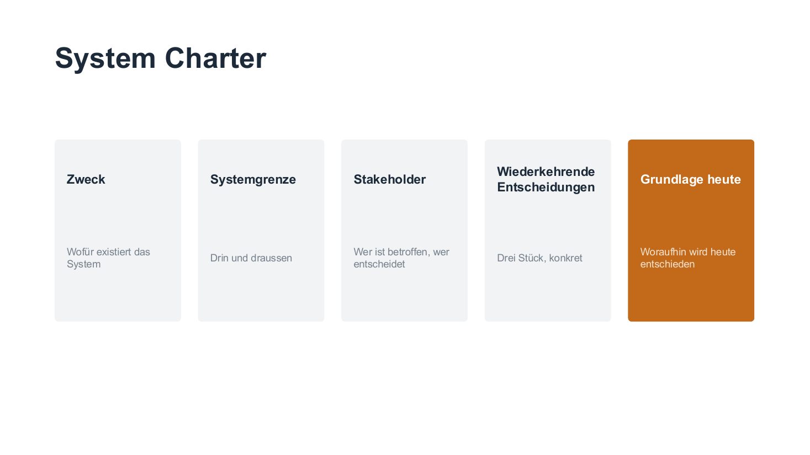

*System Charter: die fünf Felder (KK Woche 1)*

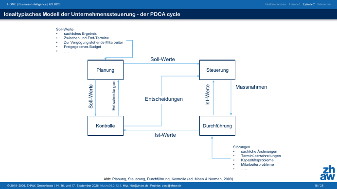

*PDCA-Zyklus: Planung, Durchführung, Kontrolle, Steuerung (Woche 1)*

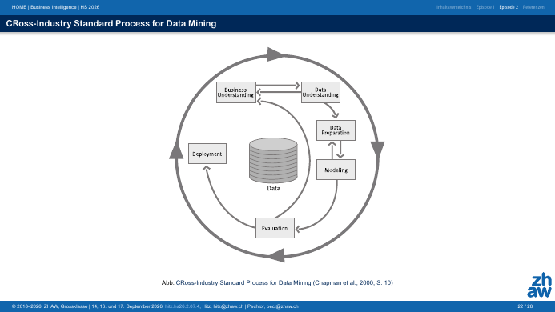

*CRISP-DM: zyklischer Prozess, beginnt beim Business Understanding (Woche 1)*

Kriterien für ein geeignetes System: klare Grenze, überschaubarer Betrieb, wiederkehrende Entscheidungen, etwas ist messbar (Mengen, Zeiten, Häufigkeiten).

**Achtung:** Die Lernpyramide von Edgar Dale (Cone of Learning) ist wissenschaftlich nicht haltbar. Sie war das Beispiel für «alike-scientific» Modelle.

### Vertiefung Woche 1

| Thema                            | Kernaussage                                                                                                                                |
|----------------------------------|--------------------------------------------------------------------------------------------------------------------------------------------|
| Intellekt vs. Intelligenz        | Intellekt = Erkenntnisvermögen, Verstand. Intelligenz = Fähigkeit, kognitive Fähigkeiten zur Problemlösung einzusetzen.                    |
| Models as perception of reality  | Modelle sind keine reinen Abbilder; sie verändern durch Rückkopplung auch die Realität.                                                    |
| Hinton                           | Pionier des Deep Learning (Boltzmann Machine 1985 mit Sejnowski, Backpropagation mit LeCun und Bengio); warnt vor Kontrollverlust über KI. |
| Integral GRC (Racz et al., 2010) | Governance, Risk und Compliance als integriertes Rahmenwerk.                                                                               |
| Applied Data Science             | Pure vs. Applied Data Science, darunter Business Data Science (Christiansen et al., 2022).                                                 |
| KDD-Prozess (Fayyad 1996)        | Selection → Preprocessing → Transformation → Data Mining → Interpretation/Evaluation → Knowledge. Linear mit Rücksprüngen.                 |
| Leistungsnachweis                | Testate in der KK in 5er-Gruppen, Pass/Fail, 3 von 3 für die Prüfungszulassung. Keine Punkte für Trittbrettfahrer.                         |
| Projektjournal                   | Annahmen, Quellen, Entscheidungen und dokumentierte AI-Nutzung festhalten.                                                                 |

## Woche 2: Ashby, Beer, Kontextdiagramm und CLD

Ein System lässt sich nur steuern, wenn die Steuerung mindestens so viel Vielfalt erfassen kann wie das, was sie steuern soll. Daraus folgt die Frage für BI: Welche Signale müssen für wen sichtbar werden?

| Modell                          | Was es zeigt                                                                                                                                                                 | So wendest du es an                                                                                                        |
|---------------------------------|------------------------------------------------------------------------------------------------------------------------------------------------------------------------------|----------------------------------------------------------------------------------------------------------------------------|
| Ashby: Law of Requisite Variety | Nur Varietät kann Varietät absorbieren. Hat der Regler kein mentales Modell eines Bauteils (Sicherung im Schaltkreis), verliert er die Kontrolle.                            | Fragen: Welche Zustände der Umwelt muss die Entscheidungsperson unterscheiden können?                                      |
| Kompliziert vs. komplex         | Kompliziert = viele, verschiedene Elemente und Beziehungen. Komplex = Veränderlichkeit im Zeitablauf.                                                                        | Eine Pizzeria am Wochenende ist komplex, weil sich die Nachfrage ständig ändert.                                           |
| Beer: Viable System Model       | Lebensfähige Systeme brauchen fünf Funktionen: S1 Wertschöpfung, S2 Koordination, S3 Steuerung (Innen und Jetzt), S3\* Audit, S4 Umwelt und Zukunft, S5 Identität. Rekursiv. | Funktionen, nicht Personen zuordnen. Eine Person kann mehrere Funktionen haben.                                            |
| Kontextdiagramm                 | System in der Mitte, externe Akteure rundherum, Pfeile mit In- und Outputs, Systemgrenze                                                                                     | Alle relevanten Akteure und Störgrössen (Wetter, Events) einzeichnen. Diese Störgrössen braucht es später für Feedforward. |
| Causal Loop Diagram (CLD)       | Variablen, Kausalpfeile mit + (gleichgerichtet) oder − (gegengerichtet), Schleifen R (verstärkend) und B (ausgleichend), Verzögerungen                                       | Variablen als Mengen formulieren, die steigen oder sinken können.                                                          |
| Nominal Group Technique (NGT)   | Strukturierte Gruppenmethode, um Variablen für das CLD zu sammeln                                                                                                            | Kennen, nicht anwenden.                                                                                                    |

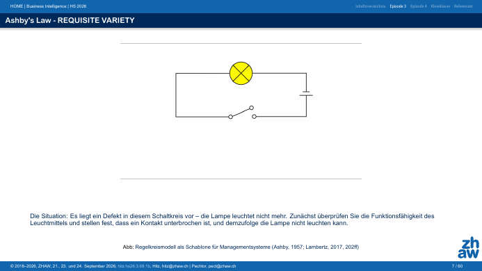

*Ashby: Regelkreis als Schablone für Managementsysteme (Woche 2)*

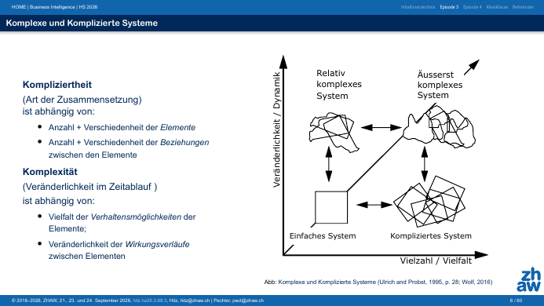

*Kompliziert vs. komplex nach Ulrich und Probst (Woche 2)*

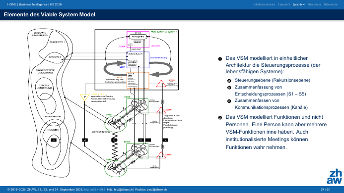

*Viable System Model: S1 bis S5 und S3-Stern (Woche 2)*

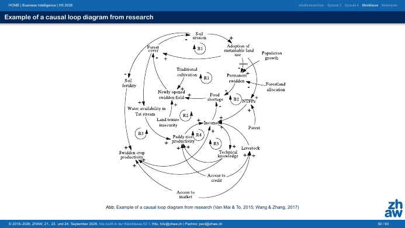

*Beispiel eines Causal Loop Diagram mit R- und B-Schleifen (Woche 2)*

**Trick für R oder B:** Zähle die − Pfeile in einer Schleife. Gerade Anzahl (auch null) = R, ungerade Anzahl = B.

**Achtung beim CLD:** Variablen sind neutral formuliert («Anzahl Bestellungen», nicht «zu viele Bestellungen»). Verzögerungen mit ‖ auf dem Pfeil markieren.

### Vertiefung Woche 2: Episode 3, klassisches vs. modernes BI

Episode 3 fragt: Wann ist ein System komplex, welche Systemmodelle helfen dabei, und wie haben sich die Referenzmodelle für BI verändert?

| Modell                                              | Kernaussage                                                                                                                                                                                                                           | Merkpunkt für Single Choice                                                              |
|-----------------------------------------------------|---------------------------------------------------------------------------------------------------------------------------------------------------------------------------------------------------------------------------------------|------------------------------------------------------------------------------------------|
| Triviale vs. nicht-triviale Maschine (von Foerster) | Triviale Maschine: gleicher Input gibt immer gleichen Output (x → f → y). Nicht-triviale Maschine: hat einen inneren Zustand z, der sich verändert; gleicher Input kann anderen Output geben.                                         | Organisationen sind nicht-triviale Maschinen, deshalb sind sie nicht exakt vorhersagbar. |
| St. Galler Management-Modell (SGMM)                 | Umweltsphären (Gesellschaft, Natur, Technologie, Wirtschaft), Anspruchsgruppen, Prozesse (Management-, Geschäfts-, Unterstützungsprozesse), Ordnungsmomente (Strategie, Struktur, Kultur), Entwicklungsmodi (Optimierung, Erneuerung) | Hans Ulrich hat Beers Kybernetik für die BWL nutzbar gemacht.                            |
| Maslow und Reifegrade                               | Wie bei Maslow bauen BI-Bedürfnisse aufeinander auf: Data Ingestion → Cleansing und Storage → Data Warehousing → Descriptive → Diagnostic → Predictive → Prescriptive                                                                 | Ohne saubere Datenbasis keine Prognose.                                                  |
| DWH-Referenzarchitektur (Gansor, Kemper)            | Quellsysteme → ETL/Staging → Core DWH → Data Marts → Analyse und Präsentation, dazu Metadaten                                                                                                                                         | Klassisches BI ist zentral und batchorientiert.                                          |
| IMC-enabled DWH                                     | In-Memory Computing verkürzt die Wege zwischen operativen und analytischen Systemen                                                                                                                                                   | Modernes BI ist schneller, näher an Echtzeit.                                            |
| Service-orientierte BI-Architektur                  | BI-Funktionen als Dienste, die sich kombinieren lassen                                                                                                                                                                                | Flexibler als ein monolithisches DWH.                                                    |
| CPM vs. BI                                          | Corporate Performance Management nutzt BI als Basis für Planung, Steuerung und Kontrolle der Unternehmensleistung                                                                                                                     | CPM ist der Steuerungsprozess, BI die Informationsgrundlage.                             |
| Ebenen des BI-Verständnisses (Gluchowski)           | Enges BI (Datenanalyse), analyseorientiertes BI, weites BI (gesamter Prozess von Daten bis Entscheidung)                                                                                                                              | Das Modul folgt dem weiten Verständnis.                                                  |
| Systemisches Management (Berghaus)                  | Organisationen als komplexe, sich selbst organisierende Systeme                                                                                                                                                                       | Paradigmenwechsel von Kontrolle zu Lenkung.                                              |

**VSM im Detail:**

- **Rekursion:** Jedes System 1 ist selbst wieder ein lebensfähiges System mit S1 bis S5. S2 bis S5 sind Dienstleister für S1.

- **Sechs Kanäle:** (i) Intervention, (ii) Ressourcenverhandlung, (iii) operative Verbindungen, (iv) Überschneidung der Umwelten, (v) Anti-Oszillation (S2), (vi) Audit (S3\*).

- **S3 und S4:** S3 ist «Innen und Jetzt», S4 ist «Aussen und Dann» (Radar). S5 löst Konflikte zwischen beiden und steht für Identität und Werte.

- **Algedonische Schleife:** direkter Alarmkanal (Schmerz oder Belohnung) von unten nach ganz oben, wenn etwas kritisch wird.

- *S3 braucht Fehlerkultur:*\* Sonst werden Ergebnisse beschönigt.

- **Cybersyn:** Beers Anwendung des VSM auf den chilenischen Staat (1970er).

**NGT für Variablen (Vennix):** Problem rahmen → Mapping starten → Variablen still sammeln → reihum nennen → klären → priorisieren. Divergente Methode, etwa 20 Minuten. Vorteil: alle kommen zu Wort, keine Dominanz einzelner.

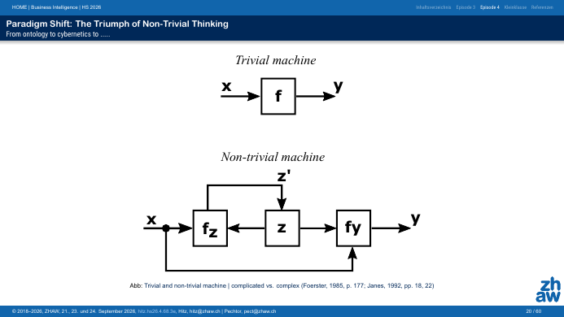

*Triviale vs. nicht-triviale Maschine nach von Foerster (Woche 2)*

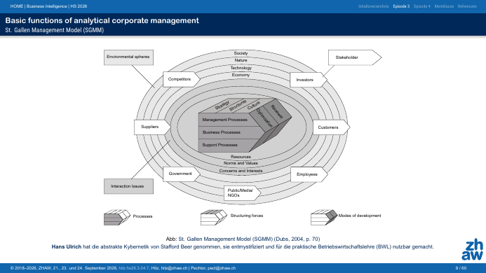

*St. Galler Management-Modell (Woche 2)*

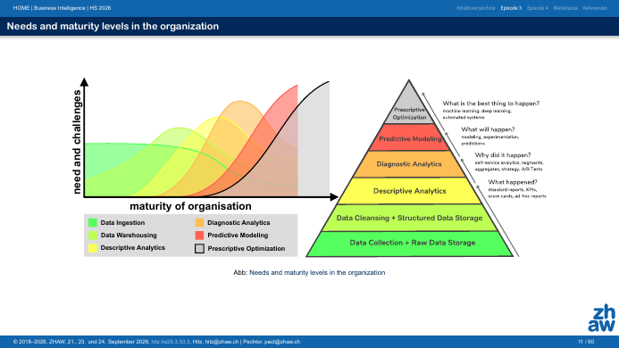

*Bedürfnisse und Reifegrade der Organisation (Woche 2)*

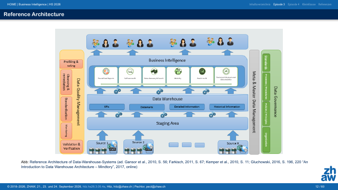

*Referenzarchitektur von Data-Warehouse-Systemen (Woche 2)*

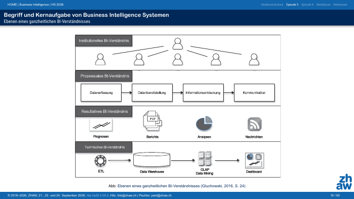

*Ebenen eines ganzheitlichen BI-Verständnisses nach Gluchowski (Woche 2)*

## Woche 3: System Dynamics, Variation und Engpässe

Plausible Einzelentscheidungen erzeugen oft unerwartete Wirkungen im Gesamtsystem, weil es Akkumulation, Rückkopplung und Verzögerungen gibt. System Dynamics will das **erklären, nicht voraussagen**: Die Systemstruktur bestimmt das Verhalten. Woche 3 hat drei Episoden: Stock-Flow-Diagramme, Modellvalidierung und «Daten, das neue Erdöl» mit den Verbesserungszyklen und Geschäftsmodellen.

| Modell                                                                     | Was es zeigt                                                                                                                                                                                                                                                                | So wendest du es an                                                                                                                                                                    |
|----------------------------------------------------------------------------|-----------------------------------------------------------------------------------------------------------------------------------------------------------------------------------------------------------------------------------------------------------------------------|----------------------------------------------------------------------------------------------------------------------------------------------------------------------------------------|
| Forrester: System Dynamics (Industrial Dynamics, 1961)                     | Endogene, kausale Sicht: Feedback, Verzögerungen, Akkumulation, Nichtlinearität. Ziel ist Verständnis, nicht Prognose. Harte und weiche Variablen. Fokus auf Dynamik, nicht auf Detailkomplexität.                                                                          | Im Case erklären, *warum* sich ein Problem wiederholt, nicht nur *dass*.                                                                                                               |
| PHAPI (Forrester 1994)                                                     | Problem (Referenzverhalten über Zeit) → Hypothesen (formales Modell) → Analysen (Simulation) → Policy Design (bessere Strukturen testen) → Implementation                                                                                                                   | Unterschied zu CRISP-DM: PHAPI startet beim Problemverhalten und erklärt es über Struktur; CRISP-DM startet beim Geschäftsverständnis und baut datengetriebene Modelle.                |
| Stock-Flow-Elemente (Bala et al. 2017)                                     | Drei Typen: Bestand, Fluss, Parameter. Zwei Verbindungen: Materialfluss (Doppelpfeil mit Ventil) und Informationsfluss (einfacher Pfeil). Zwei Grenzen: Quelle und Senke (Wolke).                                                                                           | Bestände werden **nur** durch Flüsse verändert. Ein Informationspfeil zeigt nie in einen Bestand. Bi-Flows vermeiden. Bestände können Ketten bilden.                                   |
| Bausteine sozialer Systeme (Warren 2008)                                   | Akkumulation, Feedback (R verstärkend, B ausgleichend), Verzögerungen                                                                                                                                                                                                       | Beispiel R: mehr Kunden → mehr Empfehlungen → mehr Kunden. Beispiel B: mehr Kunden → schlechtere Servicequalität → weniger Kunden. Verzögerung: Einstellen dauert, bis Personal wirkt. |
| Mögliche Systemzustände                                                    | konstant, ansteigend, schrumpfend, kollabierend (Beispiel Rinderherde: R1 Geburt, B1 Sterben, begrenzt durch Gras)                                                                                                                                                          | Im BOT das typische Muster benennen: exponentielles Wachstum, Zielsuche, S-Kurve, Oszillation, Kollaps.                                                                                |
| Modellvalidierung                                                          | Interne Gültigkeit (widerspruchsfrei, fehlerfrei) vs. externe Gültigkeit (übertragbar). Logischer Empiriker (Modell wahr oder falsch) vs. Relativist (Modell mehr oder weniger nützlich, Barlas & Carpenter 1990). Black-Box (Output passt) vs. White-Box (Struktur passt). | Ein höheres R² macht ein Modell nicht besser. «All models are wrong, but some are useful» (Box). Validierung ist zweckabhängig.                                                        |
| Bull’s-Eye-Diagramm (Ford 1999)                                            | Innen endogene Variablen (vom Modell erklärt), dann exogene (wirken von aussen), aussen ausgeschlossene                                                                                                                                                                     | Systemgrenze begründen: Sie hängt vom Zweck des Modells ab, sonst wird Modellieren endlos.                                                                                             |
| Eisbergmodell (Sweeney & Meadows 1996)                                     | Events (reagieren) → Patterns (antizipieren) → Structure (gestalten) → Mental Models (transformieren). Die Hebelwirkung steigt nach unten.                                                                                                                                  | Nicht auf einzelne Ereignisse reagieren, sondern Muster und Struktur suchen.                                                                                                           |
| PDCA und Kaizen (Shewhart)                                                 | Plan, Do, Check, Act als kontinuierliche Verbesserung                                                                                                                                                                                                                       | Grundzyklus der datengetriebenen Steuerung.                                                                                                                                            |
| DMAIC, Six Sigma (Deming)                                                  | Define, Measure, Analyze, Improve, Control. «In God we trust. All others must bring data.»                                                                                                                                                                                  | Verbesserung auf Basis von Messung.                                                                                                                                                    |
| Theory of Constraints, POOGI (Goldratt)                                    | Fünf Fokussierungsschritte: Engpass identifizieren, ausnutzen, alles andere unterordnen, erweitern, wiederholen (keine Trägheit)                                                                                                                                            | Den Engpass benennen (Pizzeria: Ofen) und Kapazität in seiner Einheit messen. Lokale Optimierung abseits des Engpasses bringt nichts.                                                  |
| Digitale Geschäftsmodelle (Hitz & Schwer 2018)                             | Vier Dimensionen: Authority (Stakeholder), Capacity (Markt), Competency (Peers), Enabling (Lieferanten)                                                                                                                                                                     | Beispiele Trivago, Rome2Rio: Daten als Kern des Geschäftsmodells.                                                                                                                      |
| Business Model Canvas (Osterwalder 2005)                                   | Neun Bausteine: Schlüsselpartner, -aktivitäten, -ressourcen, Nutzenversprechen, Kundenbeziehungen, Kanäle, Kundensegmente, Kostenstruktur, Einnahmequellen                                                                                                                  | Single-Choice-Wissen. Data Product Canvas (Woche 6) ist daran angelehnt.                                                                                                               |
| Value Proposition Canvas (Osterwalder)                                     | Kundenprofil (Jobs, Pains, Gains) vs. Wertangebot (Produkte, Pain Relievers, Gain Creators)                                                                                                                                                                                 | Passung zwischen Angebot und Kundenbedürfnis.                                                                                                                                          |
| Kleinklasse: BOT, CLD v1, Assumption and Evidence Register, Fragenliste v0 | CLD mit zwei bis vier erklärbaren Schleifen, Verzögerungen, Engpass, Hebelpunkten. Register trennt Beobachtung, Stakeholderaussage, Quelle, Teamannahme, AI-Vorschlag.                                                                                                      | Zeigt, was belegt und was nur angenommen ist.                                                                                                                                          |

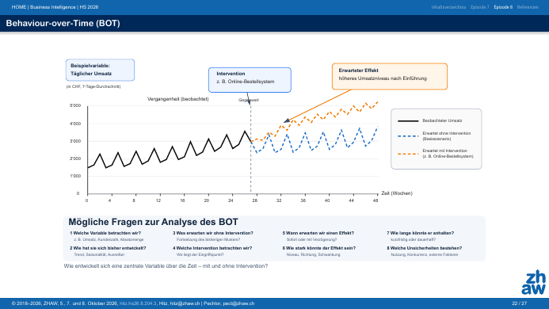

*Behaviour-over-Time mit den acht Leitfragen (Folie aus Woche 4)*

**Achtung:** Ein BOT ist keine Prognose mit echten Zahlen, sondern ein erwartetes Muster. Die acht Leitfragen auf der BOT-Folie (welche Variable, bisheriger Verlauf, ohne Intervention, Intervention, wann, wie stark, wie lange, welche Unsicherheiten) sind eine gute Checkliste.

**Fragen aus den Lernzielen, die du beantworten können solltest:**

- Was bedeutet PHAPI, und worin unterscheidet es sich von CRISP-DM?

- Welche Elemente hat ein Stock-Flow-Diagramm?

- Warum zeigt ein Informationsfluss nie in einen Bestand? (Weil ein Bestand nur durch Flüsse verändert wird.)

- Wie muss man Modelle verstehen und interpretieren? (Vereinfachungen, zweckabhängig validiert, Erklärung statt Prognose.)

- Weshalb ist die ursächliche Sicht eine Grundlage der Planung, und welche datengetriebenen Zyklen gibt es? (PDCA, DMAIC, POOGI)

- Wann ist ein Geschäftsmodell datengetrieben?

**Übungen aus der Vorlesung (gute Prüfungsvorbereitung):**

| Übung            | Struktur                                                                                                             | Was man lernt                                                                                                                                            |
|------------------|----------------------------------------------------------------------------------------------------------------------|----------------------------------------------------------------------------------------------------------------------------------------------------------|
| Workforce hiring | Bestand Personal; Diskrepanz = Soll minus Ist; Einstellungsrate = Diskrepanz / Anpassungszeit (4 Wochen)             | Zielsuchende B-Schleife: das Personal nähert sich dem Soll asymptotisch. Einheiten prüfen (Personen pro Woche).                                          |
| Quality erosion  | Qualität zerfällt mit durchschnittlicher Zerfallszeit (3 Jahre), Verbesserung schliesst die Lücke zum Ziel (2 Jahre) | Zwei B-Schleifen gegeneinander. Wenn das Ziel selbst sinkt (erodierende Ziele), sinkt die Qualität trotz Verbesserung.                                   |
| Romeo und Julia  | Zwei Bestände (Liebe von Romeo, Liebe von Julia), die sich gegenseitig verändern                                     | Ergibt eine Oszillation (harmonischer Oszillator). Reagiert eine Seite schneller, verändert sich Frequenz und Phase. Darstellungstyp: Stock-Flow-Modell. |

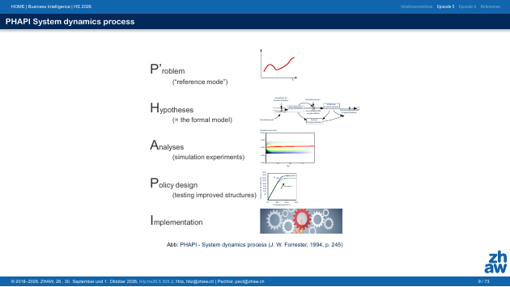

*PHAPI: System-Dynamics-Prozess nach Forrester (Woche 3)*

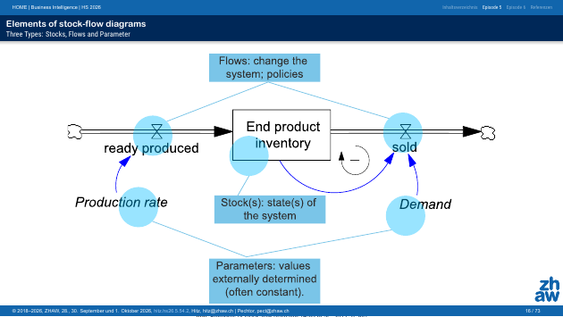

*Elemente eines Stock-Flow-Diagramms: Bestand, Fluss, Parameter (Woche 3)*

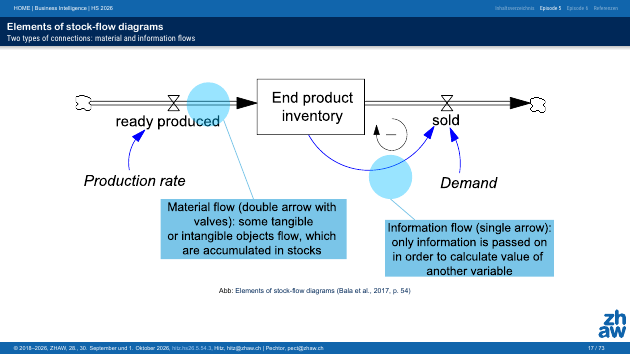

*Materialfluss vs. Informationsfluss (Woche 3)*

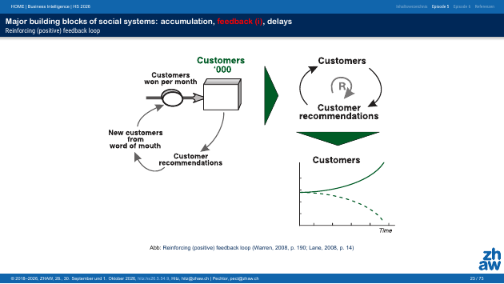

*Verstärkende Schleife nach Warren (Woche 3)*

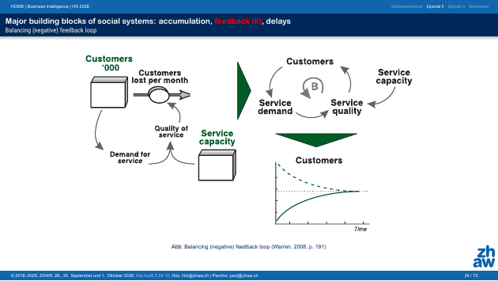

*Ausgleichende Schleife nach Warren (Woche 3)*

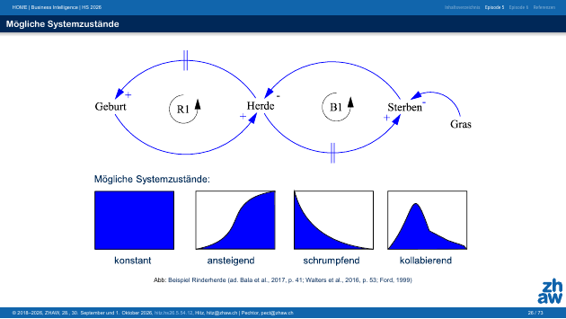

*Mögliche Systemzustände am Beispiel Rinderherde (Woche 3)*

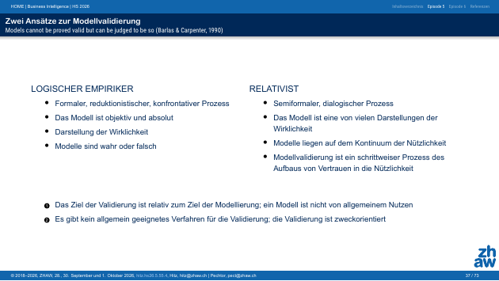

*Zwei Ansätze zur Modellvalidierung nach Barlas & Carpenter (Woche 3)*

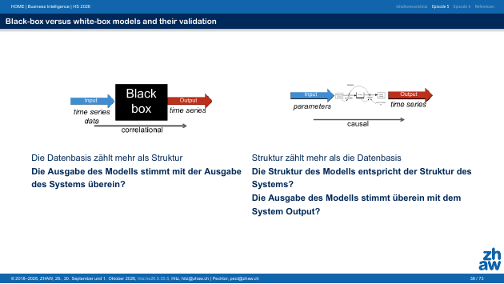

*Black-Box- vs. White-Box-Modelle (Woche 3)*

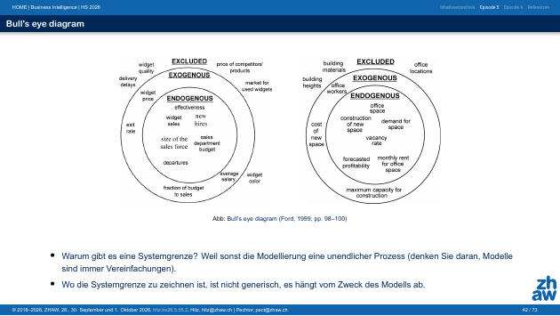

*Bull’s-Eye-Diagramm nach Ford: endogen, exogen, ausgeschlossen (Woche 3)*

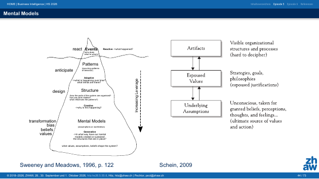

*Mental Models: Events, Patterns, Structure, Mental Models (Woche 3)*

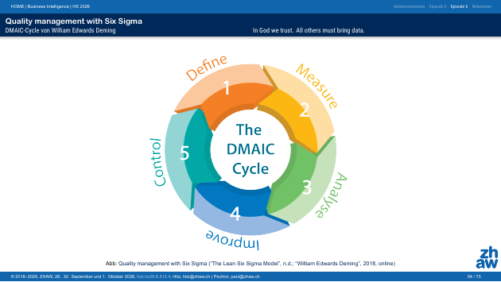

*DMAIC-Zyklus, Six Sigma (Woche 3)*

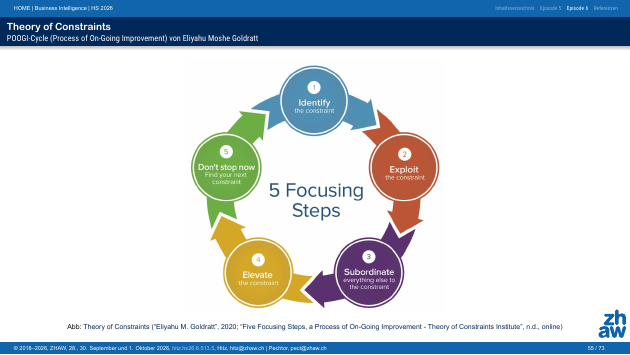

*Theory of Constraints: fünf Fokussierungsschritte (Woche 3)*

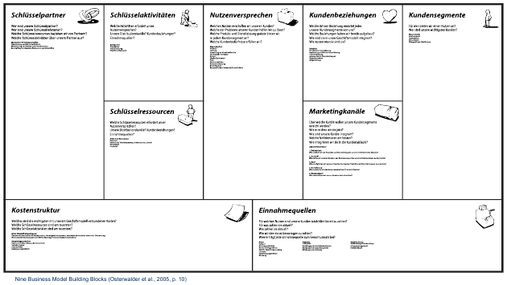

*Business Model Canvas nach Osterwalder (Woche 3)*

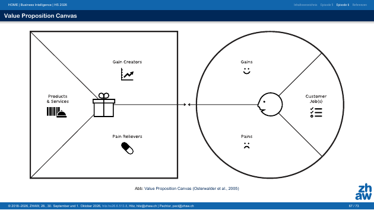

*Value Proposition Canvas (Woche 3)*

### Vertiefung Woche 3: Stock-Flow-Diagramm und das Bäckerei-Modell

Das CLD zeigt, *was* auf *was* wirkt. Das Stock-Flow-Diagramm (SFD) zeigt zusätzlich, *was sich ansammelt* und *wie schnell*. Beide verwenden dieselben Variablennamen, und jeder Pfeil im CLD entspricht einer Abhängigkeit im SFD.

| Element im SFD        | Symbol                 | Bedeutung                                           | Beispiel Bäckerei                                   |
|-----------------------|------------------------|-----------------------------------------------------|-----------------------------------------------------|
| Bestand (Stock)       | Rechteck               | Sammelt sich an, hat zu jedem Zeitpunkt einen Wert  | Backwaren im Laden, Stammkundschaft                 |
| Fluss (Flow)          | Doppelpfeil mit Ventil | Verändert den Bestand pro Zeiteinheit               | Produktion, Verkauf, Abfall, Neukunden, Abwanderung |
| Quelle / Senke        | Wolke (Kreis)          | Kommt von ausserhalb oder verlässt die Systemgrenze | Woher Kunden kommen, wohin Abfall geht              |
| Hilfsvariable         | Text                   | Berechnete Grösse                                   | Nachfrage, Verfügbarkeit, Bestandslücke             |
| Konstante / Parameter | Text ohne Zufluss      | Fester Wert                                         | Backkapazität 800 Stück/Tag, Anpassungszeit 5 Tage  |
| Informationspfeil     | dünner Pfeil           | Abhängigkeit                                        | Bestandslücke → Produktion                          |

**Die Schleifen der Bäckerei (Lehrbeispiel aus dem Begleitdokument):**

| Schleife                 | Weg                                                                                          | Typ und Bedeutung                                                          |
|--------------------------|----------------------------------------------------------------------------------------------|----------------------------------------------------------------------------|
| R1 Empfehlung            | Stammkundschaft → Neukunden → Stammkundschaft                                                | Verstärkend: mehr Stammkunden bringen mehr Empfehlungen                    |
| B1 Bestandsregelung      | Backwaren im Laden → Bestandslücke → Produktion → Backwaren im Laden                         | Ausgleichend: sinkt der Bestand, wird mehr gebacken. Das ist **Feedback**. |
| B2 Grenzen des Wachstums | Stammkundschaft → Grundnachfrage → Nachfrage → Verfügbarkeit → Abwanderung → Stammkundschaft | Ausgleichend: reicht die Backkapazität nicht, wandert Kundschaft ab        |
| Verzögerung              | Grundnachfrage → Erwartete Grundnachfrage (‖)                                                | Die Erfahrung der Inhaberin läuft der Nachfrage 5 Tage hinterher           |
| Feedforward              | Zusatznachfrage durch Anlass → Prognostizierte Nachfrage                                     | Der angekündigte Anlass fliesst direkt in die Planung, an B1 vorbei        |

**Was die Simulation zeigt (Dorffest Tag 20 bis 23, +150 Stück/Tag):**

| Ergebnis                                   | Ohne Feedforward | Mit Feedforward |
|--------------------------------------------|------------------|-----------------|
| Tiefste Verfügbarkeit während des Anlasses | 85 %             | 100 %           |
| Entgangener Verkauf während des Anlasses   | rund 234 Stück   | 0 Stück         |
| Stammkundschaft an Tag 30                  | 250 Personen     | 270 Personen    |

In beiden Läufen endet das Wachstum bei rund 383 Personen, weil ab etwa Tag 60 die Backkapazität (800 Stück/Tag) erreicht ist und B2 bremst. Das ist der **Engpass** im Sinne von Goldratt.

**Kritik am Modell (prüfungsrelevant):** Die Zahlen sind frei gewählt, aussagekräftig ist nur das Verhaltensmuster. Die Vorsteuerung ist unrealistisch perfekt. Geld, Tageszeiten und Personal fehlen. Ein Modell ist ein Startbeispiel, kein geprüftes Abbild der Realität.

**So zeichnest du ein CLD im Case:**

1.  Problemvariable in die Mitte (z. B. Verfügbarkeit, Wartezeit).

2.  Ursachen und Folgen als neutrale Mengen davor und danach.

3.  Pfeile mit + oder − beschriften.

4.  Schleifen suchen, mit R oder B benennen und kurz beschriften (z. B. «B1 Bestandsregelung»).

5.  Mindestens eine Verzögerung (‖) und eine Störgrösse aus dem Kontextdiagramm einzeichnen.

6.  Engpass und Hebelpunkt markieren.

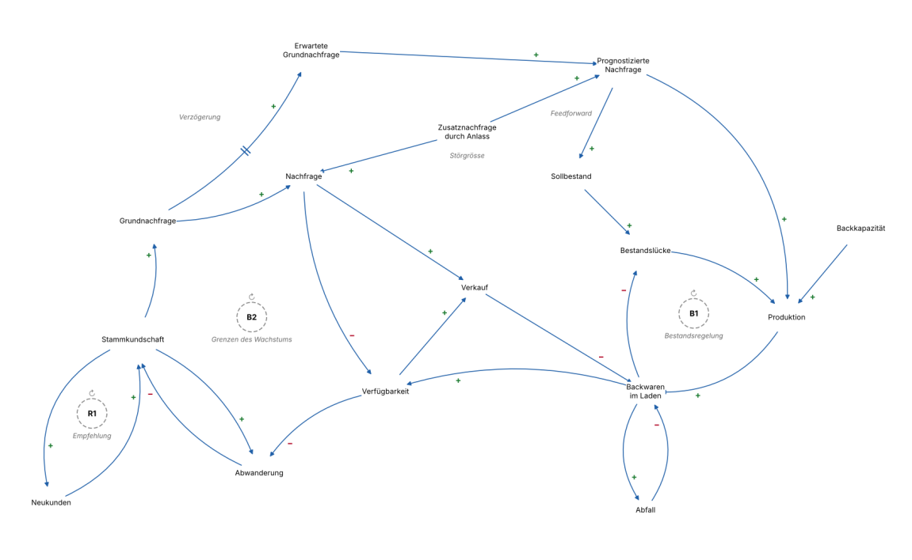

*CLD der Bäckerei mit R1, B1, B2, Verzögerung und Feedforward (Begleitdokument Woche 5)*

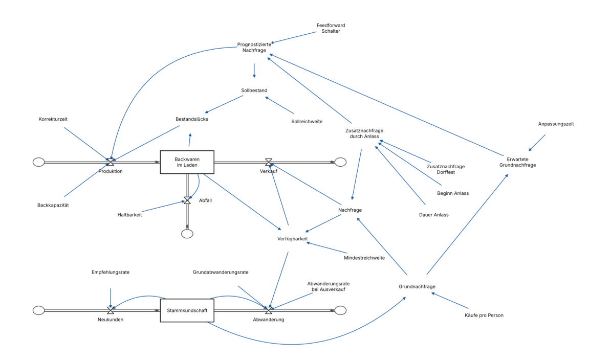

*Stock-Flow-Diagramm der Bäckerei mit Beständen, Flüssen und Parametern (Begleitdokument Woche 5)*

## Woche 4: Target-Centric Analysis (Clark), Fragen 1 und 2

Analyse ist kein linearer Zyklus, sondern alle arbeiten gleichzeitig am selben Modell des Problems, dem Target. Die Entscheidungsperson stellt Fragen, die Analysten schliessen Lücken, und beide verändern das Target laufend.

| Modell                          | Was es zeigt                                                                                                                                         | So wendest du es an                                                          |
|---------------------------------|------------------------------------------------------------------------------------------------------------------------------------------------------|------------------------------------------------------------------------------|
| Clark: Target-Centric Approach  | Links die Kundenseite: Problem → Bedarf → Target → Antworten. Rechts die Analystenseite: Lücken → Informationsquellen → neue Informationen → Target. | Target = Zielmodell aus System Charter, Kontextdiagramm, CLD und Stock-Flow. |
| Ladder of Inference (Argyris)   | Von beobachtbaren Daten über ausgewählte Daten, Bedeutungen, Annahmen und Schlussfolgerungen zu Überzeugungen und Handlungen                         | Erklärt, warum Teams aus denselben Daten verschiedene Schlüsse ziehen.       |
| Kontextdiagramm (Bsp. Bäckerei) | Systemgrenze, externe Akteure, Inputs und Outputs                                                                                                    | Vorlage für den Case.                                                        |
| Answer-to-Action Matrix         | Frage → benötigte Antwort → Aktion                                                                                                                   | Nur Fragen aufnehmen, die zu einer Handlung führen.                          |
| Information as a resource       | Daten → Information → Wissen → Weisheit                                                                                                              | Typische Single-Choice-Frage.                                                |

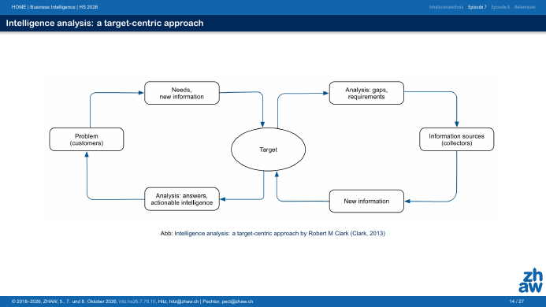

*Clark: Intelligence analysis, a target-centric approach (Woche 4)*

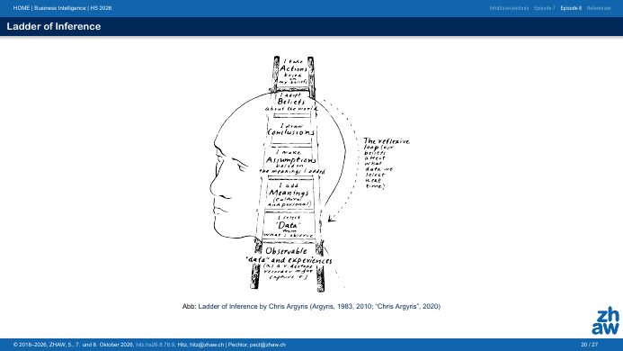

*Ladder of Inference nach Argyris (Woche 4)*

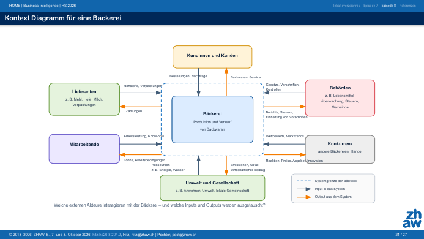

*Kontextdiagramm am Beispiel Bäckerei (Woche 4)*

**Wichtigster Prüfungsfehler:** Mit «customer» meint Clark die Person, die auf Basis der Analyse entscheidet. Das ist nicht die Kundschaft des Systems. Bei der Bäckerei ist es die Inhaberin, nicht die Person, die ein Croissant kauft.

### Vertiefung Woche 4

**Leitgedanke von Episode 8:** Vom interessanten Befund zum actionable insight. Eine Antwort ist nur relevant, wenn sie eine Entscheidung oder Handlung verändern kann. Frage 1 (Data-driven Discovery) sucht aus Sicht von System Dynamics, wo im System etwas zu entdecken ist. Frage 2 (Data-driven Analysis) fragt, welche Antworten gebraucht werden und welche Handlung bei unterschiedlichen Antworten ausgelöst würde.

| Modell                           | Kernaussage                                                                                                                                                       | Merkpunkt                                           |
|----------------------------------|-------------------------------------------------------------------------------------------------------------------------------------------------------------------|-----------------------------------------------------|
| Senge: The Fifth Discipline      | Fünf Disziplinen der lernenden Organisation: Personal Mastery, Mental Models, Shared Vision, Team Learning und Systems Thinking als fünfte, verbindende Disziplin | Systemdenken verbindet die anderen vier.            |
| Cao: Scientific Thinking Process | Wissenschaftliches Vorgehen in Data Science: beobachten, Hypothese bilden, testen, interpretieren, iterieren                                                      | BI soll Hypothesen prüfen, nicht nur Zahlen zeigen. |
| Data Lifecycle Framework (MSU)   | Datenlebenszyklus eingebettet in Kontext: Workforce und Literacy, Ownership und Privacy, Hardware und Security, Domain Goals, Vermeidung von Bias                 | Daten sind nie nur Technik.                         |
| Skills Set Data Science (Hitz)   | Mathematik und Statistik, Data Engineering, Computing, Visualisierung, Domänenwissen, wissenschaftliche Methoden, Hacker Mindset                                  | Domänenwissen gehört zwingend dazu.                 |
| Vertikale Integration            | Vorwärts (Richtung Kunde), rückwärts (Richtung Rohstoff), horizontal (gleiche Stufe)                                                                              | Beispiel für Systemgrenzen.                         |
| Models as perception of reality  | Modelle bilden die Realität nicht neutral ab, sie verändern sie auch (Rückkopplung)                                                                               | Ein CLD ist eine Hypothese, kein Beweis.            |

**System Review (KK Woche 4):** Zweck, Systemgrenze, Stakeholder, CLD, zentrale Dynamik, Verzögerung, Engpass und Hebelpunkt präsentieren. Fünf priorisierte Steuerungsfragen und eine Answer-to-Action Matrix für die drei wichtigsten. Andere Teams fragen nach Plausibilität, Systemgrenze, Handlungsrelevanz, Nebenwirkungen und unbelegten AI-Annahmen.

**Answer-to-Action Matrix:** Für jede Frage festhalten, welche möglichen Antworten es gibt und welche Handlung jede Antwort auslöst. Beispiel: «Reicht der Teig für Samstag?» → Ja: Standardmenge · Knapp: erhöhte Menge · Nein: erhöhte Menge plus Aushilfe. Führen alle Antworten zur gleichen Handlung, ist die Frage nicht entscheidungsrelevant.

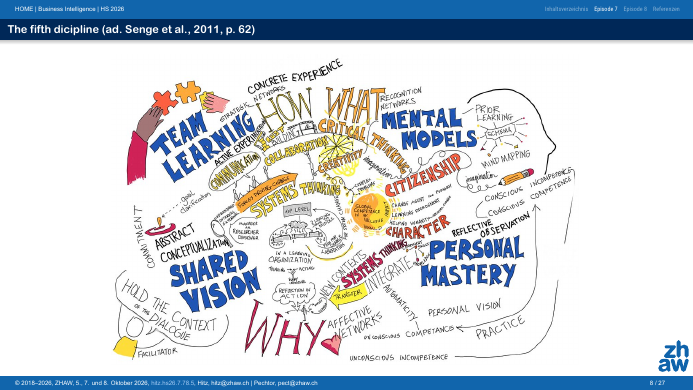

*The Fifth Discipline nach Senge (Woche 4)*

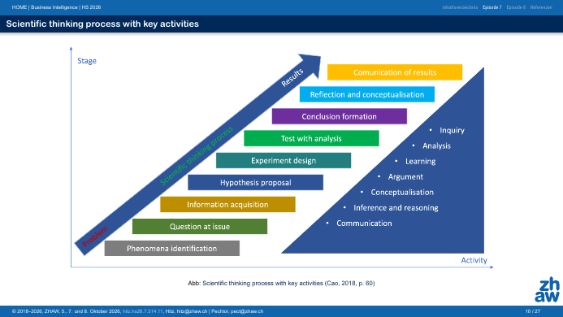

*Scientific thinking process nach Cao (Woche 4)*

## Woche 5: Impactanalyse und BI Mission Brief

Eine Information ist nur dann wertvoll, wenn sie eine Handlung auslöst, und jede Handlung hat Wirkungen im System, auch unerwünschte. Woche 5 schliesst deshalb den Kreis vom Signal bis zur Wirkung.

**Antwortkarte (6 Felder):** Entscheidungsperson · Entscheidung (Satz mit Verb) · Schlüsselfrage · Benötigte Antwort (Kennzahl, Vergleich, Trend, Prognose oder Ja/Nein; wie oft, bis wann) · Bezug zum Zielmodell (Bestand, Fluss, Loop, Akteur, Störgrösse) · Lücke.

**Actionable Signals Impact Analysis (7 Schritte):**

| Schritt           | Leitfrage                                       | Beispiel Bäckerei                                               |
|-------------------|-------------------------------------------------|-----------------------------------------------------------------|
| Data              | Welche Rohdaten, woher?                         | POS-Daten, Uhrzeit, Wetter                                      |
| Insight           | Welche Information ergibt sich?                 | Nachfrage nach Croissants 7 bis 9 Uhr ist höher als der Bestand |
| Actionable Signal | Regel mit Schwellenwert: Wenn …, dann …         | Wenn erwarteter Bestand um 7 Uhr \< 20, dann zusätzliche Charge |
| Decision          | Welche Entscheidung wird ermöglicht?            | Zusatzproduktion vor 7 Uhr einplanen                            |
| Action            | Was wird getan, von wem?                        | Charge backen, Bäckerei-Team                                    |
| System Response   | Wie reagiert das System? Entlang der CLD-Pfeile | Weniger leere Regale, mehr Arbeit am Morgen                     |
| Consequences      | Erwünschte und unerwünschte Folgen              | Mehr Umsatz, aber mehr Abfall, wenn Nachfrage ausbleibt         |

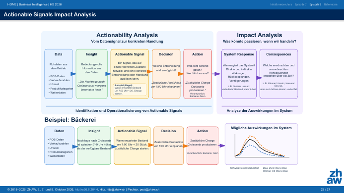

*Actionable Signals Impact Analysis mit Beispiel Bäckerei (Woche 4 und 5)*

Die ersten fünf Schritte sind die Actionability Analysis, die letzten zwei die Impact Analysis.

| Begriff                    | Bedeutung                                                                                                 |
|----------------------------|-----------------------------------------------------------------------------------------------------------|
| Feedback (Regelung)        | Reagiert auf eine Abweichung zwischen Soll und Ist, nachdem sie passiert ist                              |
| Feedforward (Vorsteuerung) | Reagiert auf eine Störgrösse, bevor sie wirkt (z. B. Dorffest angekündigt)                                |
| Wirkungshypothese          | Wenn wir X tun, dann Y, weil \[Pfad im CLD\]. Widerlegt, wenn Z. Mindestens eine nennt eine Nebenwirkung. |

**BI Mission Brief:** höchstens drei Seiten, sieben Abschnitte (Auf einen Blick, Problem und Systemgrenze, Systemmodell, Priorisierte Fragen, Handlungen und Signale, Wirkungshypothesen, Datenbedarf und Auftrag). Drei Regeln: **Lesertest** (handelt die Person danach anders?), **Herkunft** (stammt jeder Abschnitt aus einem Artefakt?), **kleiner Auftrag** (prüft der erste Schritt die wichtigste Annahme günstig, z. B. mit einer Strichliste?).

**Häufige Fehler:** Kennzahl statt Entscheidung, nur Rückblick ohne Feedforward, Signal ohne Schwellenwert, Wirkung ohne CLD-Bezug, falsche Kundschaft.

### Vertiefung Woche 5: Frage 3, Frage 4 und Decision Context Cards

Die Folien zu Episode 9 und 10 lagen nicht im Ordner. Diese Vertiefung stützt sich auf das Semesterprogramm, den Leitfaden zum Mission Brief und darauf, wie Woche 6 die Decision Context Cards weiterverwendet.

| Thema                                      | Was gemeint ist                                                                                                                                                                      | So wendest du es an                                                                                                            |
|--------------------------------------------|--------------------------------------------------------------------------------------------------------------------------------------------------------------------------------------|--------------------------------------------------------------------------------------------------------------------------------|
| Frage 3: Impactanalyse                     | Wie lässt sich zeigen, dass eine Antwort Entscheidungen verbessert, Risiken reduziert, Qualität erhöht oder Arbeit wirksamer macht?                                                  | Wirkung als prüfbare Hypothese formulieren, mit Ausgangslage und Vergleichsgrösse.                                             |
| Ausgangslage (Baseline)                    | Der heutige Zustand, gegen den man vergleicht                                                                                                                                        | Ohne Baseline lässt sich keine Verbesserung zeigen (z. B. Teigverderb heute messen).                                           |
| Führende Indikatoren                       | Zeigen früh, ob die Massnahme wirkt                                                                                                                                                  | z\. B. Anteil Bestellungen mit Fertig-Zeit innerhalb der Zusage                                                                |
| Nachlaufende Indikatoren                   | Zeigen die Wirkung erst später                                                                                                                                                       | z\. B. Bewertungen, Stammkundenanteil                                                                                          |
| Unerwünschte Nebenwirkungen                | Folgen, die niemand will                                                                                                                                                             | z\. B. mehr Abfall, mehr Arbeit am Morgen                                                                                      |
| Nachweiskonzept                            | Wie und woran die Wirkungshypothese geprüft wird                                                                                                                                     | Messgrösse, Zeitraum, Vergleich (vorher/nachher oder mit/ohne)                                                                 |
| Frage 4: Data Operations am Point of Work  | Was fehlt der konkreten Person in ihrer konkreten Arbeitssituation, zu welchem Zeitpunkt und in welcher Form?                                                                        | Nicht «das Unternehmen braucht», sondern «der Küchenchef braucht am Donnerstag um 15 Uhr …»                                    |
| Organisatorischer vs. individueller Bedarf | Organisatorisch: Kennzahlen für die Steuerung. Individuell: was eine Person im Moment der Arbeit braucht.                                                                            | Beide unterscheiden und für beide begründen.                                                                                   |
| Decision Context Card                      | Beschreibt eine wiederkehrende Entscheidungssituation einer konkreten Rolle: Rolle, Entscheidung, Auslöser und Zeitpunkt, Handlungsalternativen, Unsicherheit, benötigte Information | Pro wichtiger Entscheidung eine Karte (DC-01, DC-02). Sie wird in Woche 6 zur Quelle für den IR Catalogue («Herkunft: DC-03»). |
| Priorisierung der BI-Fragen                | Relevanz, Handlungsfähigkeit, Wirkung, Realisierbarkeit                                                                                                                              | Drei Fragen auswählen und die Wahl begründen.                                                                                  |

**Beispiel einer Wirkungshypothese nach Leitfaden:** Wenn wir vor 7 Uhr eine zusätzliche Charge backen, sobald der erwartete Bestand unter 20 liegt, dann sinkt der Anteil der Tage mit leeren Regalen, weil Verfügbarkeit → weniger Abwanderung → mehr Stammkundschaft (B2). Widerlegt, wenn der Anteil nach vier Wochen nicht sinkt. Nebenwirkung: mehr Abfall an Tagen mit tiefer Nachfrage.

**Kleinster erster Schritt (Lean Startup, Ries):** Was ist das Günstigste, das die wichtigste Hypothese widerlegen könnte? Oft eine Strichliste über vier Wochen statt eines Dashboards. Beispiele aus dem Leitfaden: Zappos fotografierte Schuhe im Laden, bevor ein Shop gebaut wurde; Dropbox zeigte zuerst ein Video.

## Woche 6: Requirements Engineering

Frage 5 übersetzt Entscheidungen in prüfbare Informationsanforderungen, noch ohne Datenquelle oder Technik vorwegzunehmen. Ein Informationsbedarf ist kein Dashboard-Wunsch.

| Modell                             | Was es zeigt                                                                                                                                                                                                            | So wendest du es an                                                                                  |
|------------------------------------|-------------------------------------------------------------------------------------------------------------------------------------------------------------------------------------------------------------------------|------------------------------------------------------------------------------------------------------|
| Information Requirements Canvas    | 9 Felder: Systemzweck · Entscheidung · Entscheidungsträger · Auslöser und Zeitpunkt · Handlungsalternativen · Entscheidungsrelevante Unsicherheit · Benötigte Information · Informationsanforderung · Erwartete Wirkung | Von oben links nach unten rechts ausfüllen. Die Unsicherheit ist der Kern.                           |
| Information Requirements Catalogue | Pro IR: ID, Kontext, Nutzerrolle, Entscheidung, Information, Auslöser, Handlung, Herkunft                                                                                                                               | IDs (IR-01) vergeben und Herkunft angeben.                                                           |
| Katalogqualität (5 Prüffragen)     | Auf BI-Frage rückführbar? Entscheidung benannt? Unsicherheit klar? Technologieneutral? Würde der Wegfall die Entscheidung verschlechtern?                                                                               | Jede IR damit kurz prüfen.                                                                           |
| Akzeptanzkriterien                 | GEGEBEN … WENN … DANN … mit Schwellenwert … gemessen durch … bei Verstoss …                                                                                                                                             | Adjektive wie «aktuell» oder «genau» in prüfbare Aussagen übersetzen.                                |
| Traceability Matrix                | Systemzweck (S) → BI-Frage (Q) → Entscheidung (D) → IR → Datenprodukt (DP) → Handlung (A) → Wirkung (W), plus Evidenzstatus                                                                                             | Viele-zu-viele ist erlaubt. Vorwärts prüfen (fehlt eine IR?) und rückwärts (ist jede IR begründet?). |
| Data Product Canvas                | Desirability (Nutzen), Feasibility (Daten, Ressourcen), Viability (langfristig tragbar)                                                                                                                                 | Kritisch: Nutzerwunsch allein ist keine Begründung.                                                  |

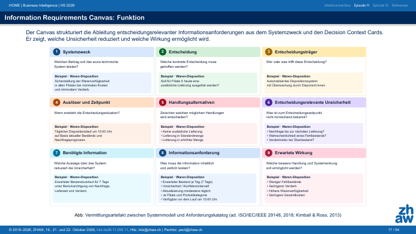

*Information Requirements Canvas mit den neun Feldern (Woche 6)*

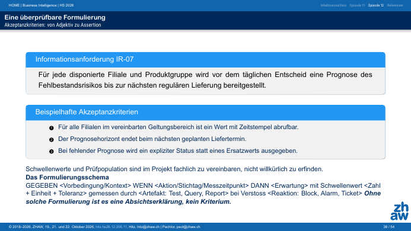

*Akzeptanzkriterien: von Adjektiv zu Assertion (Woche 6)*

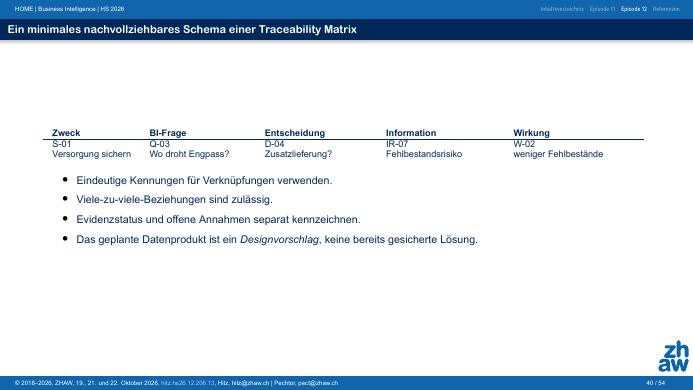

*Minimales Schema einer Traceability Matrix (Woche 6)*

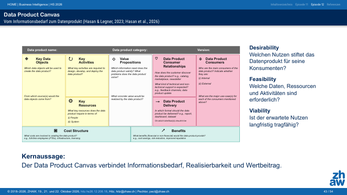

*Data Product Canvas: Desirability, Feasibility, Viability (Woche 6)*

Weitere Begriffe: **Drei Ebenen** des Informationsbedarfs (individuell, rollenbezogen, organisationsweit). **Funktional vs. nichtfunktional** (was geliefert wird vs. unter welchen Bedingungen). **Drei Zeiten** (Ereigniszeit, Bereitstellungszeit, Gültigkeit). Nicht jede Entscheidung braucht Echtzeit, und eine Punktschätzung reicht selten, es braucht eine Spanne.

**Merksatz:** Informationsanforderung = welche Aussage muss möglich sein. Datenanforderung = welche Daten mit welchen Eigenschaften. Die Datenanforderung kommt erst später.

### Vertiefung Woche 6

**Episode 11: Informationsbedarf begründen**

| Thema                                  | Kernaussage                                                                                                                                                                                                                                    |
|----------------------------------------|------------------------------------------------------------------------------------------------------------------------------------------------------------------------------------------------------------------------------------------------|
| Vier Arten von Ungewissheit            | über den Systemzustand, über kausale Mechanismen, über externe Entwicklungen, über Folgen einer Intervention                                                                                                                                   |
| Prüffrage zur Unsicherheit             | Welche möglichen Antworten würden eine andere Handlung, Priorisierung oder Eskalation rechtfertigen?                                                                                                                                           |
| Informationswert ist handlungsabhängig | Eine Information ist nur wertvoll, wenn sie Entscheidungen verbessern kann. Führen zwei verschiedene Prognosen zur gleichen Handlung, ist die genauere nicht entscheidungsrelevant. Nutzen gegen Kosten, Verzögerung und Fehlerrisiko abwägen. |
| Ashby angewendet                       | Informationsanforderungen müssen die relevanten Zustandsunterschiede abbilden (erforderliche Vielfalt).                                                                                                                                        |
| Beer angewendet                        | Rolle, Zeithorizont und Regelungsebene (S1 bis S5) verändern den Informationsbedarf.                                                                                                                                                           |
| Mensch, Workflow, Agent                | Mensch: Interpretation, Kontext, Ausnahmen. Workflow: explizite Bedingungen und Eskalationsregeln. Agent: zusätzlich maschinenlesbare Semantik und Unsicherheit. Ob etwas autonom laufen darf, ist eine separate Entscheidung (Woche 10).      |
| Unnötige Information als Systemrisiko  | Signale ohne Handlungsrelevanz erzeugen Rauschen, falsche Aggregation verdeckt lokale Probleme, redundante Kennzahlen widersprechen sich, ungeprüfte Proxies erzeugen Scheinsicherheit.                                                        |

**Episode 12: Qualität und Struktur von Anforderungen**

| Eigenschaft                  | Leitfrage                                                                                  | Beispiel                                                                                                          |
|------------------------------|--------------------------------------------------------------------------------------------|-------------------------------------------------------------------------------------------------------------------|
| Semantik                     | Was genau bedeutet der Begriff? Operationale Definition.                                   | «Bestand: 120»: physisch gezählt oder verbucht? vor oder nach Retouren?                                           |
| Granularität                 | Räumlich, sachlich, zeitlich, Entscheidungseinheit                                         | Filiale statt Region, Stunde statt Tag. Mehr Detail ist nicht automatisch besser.                                 |
| Zeit                         | Ereigniszeit, Verarbeitungszeit, Bereitstellungszeit, Gültigkeitshorizont                  | Eine Prognose um 10:05 hilft nicht für einen Entscheid um 10:00.                                                  |
| Aktualität und Latenz        | Wie alt darf eine Information sein, bevor sich die Handlung ändert?                        | Nicht jede Entscheidung braucht Echtzeit.                                                                         |
| Genauigkeit und Unsicherheit | Messfehler, Prognosefehler, Modellunsicherheit trennen; Toleranzen aus den Folgen ableiten | «100 € ± 0.01» ist eine andere Aussage als «ca. 100 €». Kosten von Fehlbestand und Verderb sind oft asymmetrisch. |
| Verfügbarkeit und Zugriff    | Wer braucht die Information im Moment der Entscheidung, wer darf sie sehen?                | Hohe Verfügbarkeit und strikte Zugriffsrechte gemeinsam spezifizieren.                                            |

**Data Product Canvas kritisch:** Ein Datenprodukt kann erwünscht, machbar und wirtschaftlich sein und trotzdem Entscheidungen unterstützen, die das Gesamtsystem gefährden. Deshalb zusätzlich prüfen: Stimmen die Systemannahmen? Was sagt S4 (Umwelt, Zukunft)? Dient es dem Zweck (S5)?

**Data Democratization kritisch:** «Jeder soll datengetrieben entscheiden» (Beispiel SAP) klingt gut, aber Nutzerwünsche allein sind keine hinreichende Begründung für BI. Die Begründung kommt aus Systemzweck und Entscheidung.

## Woche 7: Dateninventar, Profiling, Data Gap Map

Woche 7 prüft, ob die vorhandenen Daten die Informationsanforderungen wirklich stützen. Die Leitfrage: Was ist beobachtet, was ist behauptet, und was wird stillschweigend vorausgesetzt?

**Argumentationskette:** Systemzweck → Entscheidung → Unsicherheit → Informationsanforderung → Konstrukt → Evidenzanforderung → Akzeptanzkriterium → Prüfung → Data Gap → Massnahme.

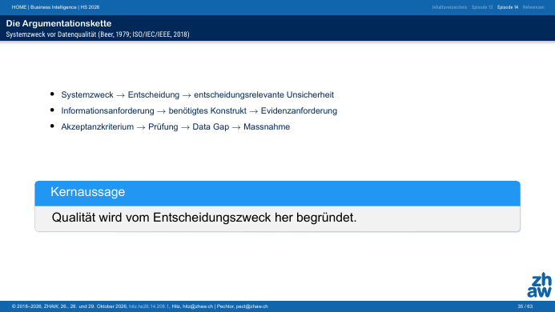

*Die Argumentationskette (Woche 7)*

| Modell                                           | Was es zeigt                                                                                                                                                  | So wendest du es an                                                                                                       |
|--------------------------------------------------|---------------------------------------------------------------------------------------------------------------------------------------------------------------|---------------------------------------------------------------------------------------------------------------------------|
| Dateninventar                                    | Quelle, System, Owner, Zugriff, Gegenstand, Granularität, Schlüssel, Aktualisierung, Historie                                                                 | Quellen nach Art ordnen: intern, extern, offen, selbst erhoben.                                                           |
| Entität, Ereignis, Zustand                       | Entität = Filiale, Ereignis = Verkauf, Zustand = Bestand zu einem Zeitpunkt                                                                                   | Prüffrage: Welcher reale Vorgang erzeugt eine Zeile?                                                                      |
| Granularität                                     | Was repräsentiert eine Zeile?                                                                                                                                 | Aggregationsfalle: Tagesumsatz lässt sich nicht in Stundennachfrage zurückrechnen.                                        |
| Temporalität                                     | Ereigniszeit, Erfassungszeit, Gültigkeitszeit, Extraktionszeit                                                                                                | Was wusste man zum Entscheidungszeitpunkt?                                                                                |
| Asserted Versioning und Nine-Fold Way (Johnston) | 4 Zeitstempel: effective from/to (fachlich gültig) und asserted from/to (wann behauptet). Eine Korrektur erzeugt eine neue Zeile.                             | Eine spätere Korrektur ist nicht rückwirkend damaliges Wissen. Ein Forecast ist eine heutige Behauptung über die Zukunft. |
| Data Profiling                                   | Struktur, Vollständigkeit, Eindeutigkeit, Wertebereiche, Beziehungen, Zeit                                                                                    | Befund immer mit Nenner: «412 von 5150 Zeilen NULL (8 %)». Befund ist noch keine Eignungsbewertung.                       |
| Konstrukt vs. Proxy                              | Konstrukt = was gemeint ist (Nachfrage). Proxy = was vorliegt (Verkäufe).                                                                                     | Immer sagen, wann der Proxy versagt (Ausverkauf, Absagen).                                                                |
| 6 Qualitätsdimensionen                           | Vollständigkeit, Korrektheit, Konsistenz, Aktualität, Eindeutigkeit, Repräsentativität                                                                        | Jede Dimension als Test mit Grundgesamtheit, Zeitbezug und Schwelle.                                                      |
| 4 Gap-Typen                                      | Verfügbarkeit (fehlt), Validität (Proxy unbegründet), Qualität (Kriterium nicht erfüllt), Lineage/Zeit (Herkunft oder damaliges Wissen nicht rekonstruierbar) | Drei verschiedene Lücken, nicht dreimal «Daten fehlen».                                                                   |
| Massnahmen                                       | Beschaffen, verbessern, einschränken, ändern oder verzichten                                                                                                  | Die Massnahme folgt aus Risiko und Systemzweck, nicht jede Lücke braucht neue Daten.                                      |
| 4 Unsicherheiten                                 | Mess-, Modell-, Abdeckungs- und Zeitunsicherheit                                                                                                              | Explizit nennen statt Scheingenauigkeit.                                                                                  |

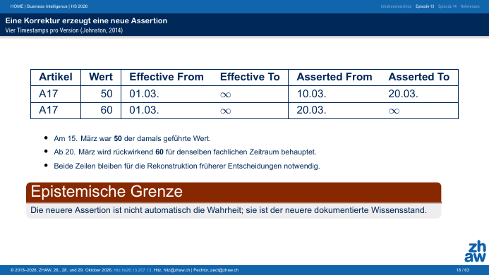

*Asserted Versioning: eine Korrektur erzeugt eine neue Assertion (Woche 7)*

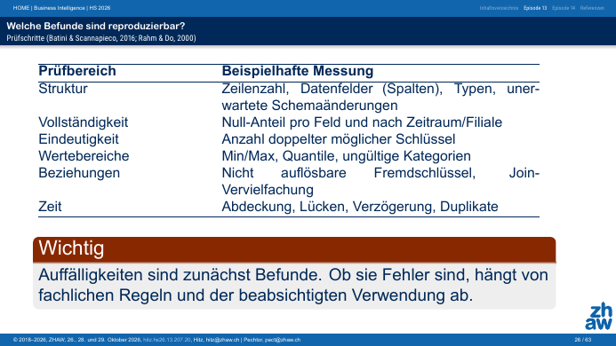

*Profiling: reproduzierbare Prüfschritte (Woche 7)*

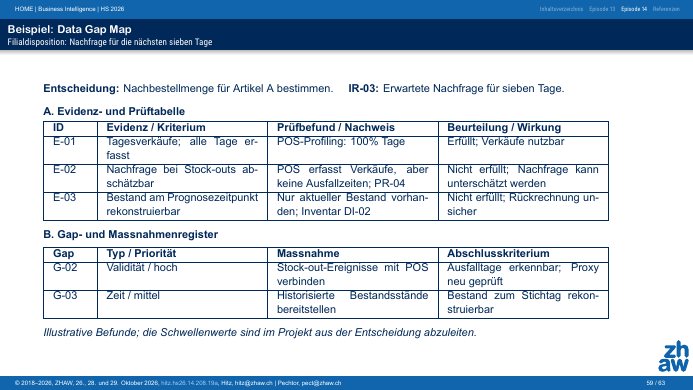

*Beispiel Data Gap Map mit Evidenztabelle und Gap-Register (Woche 7)*

**Data Gap Map** besteht aus A. Evidenz- und Prüftabelle (ID, Kriterium, Befund, Beurteilung: erfüllt, teilweise, nicht erfüllt, ungeprüft) und B. Gap- und Massnahmenregister (Gap, Typ/Priorität, Massnahme, Verantwortlich, Abschlusskriterium).

**Die drei wichtigsten Sätze:** Messvalidität vor Datenqualität. Vollständigkeit ist nicht Repräsentativität. Korrektheit ist nicht Validität: Die Kasse meldet korrekt 12 Verkäufe, aber die Nachfrage war nicht 12.

### Vertiefung Woche 7

| Thema                           | Kernaussage                                                                                                                                                 | Beispiel                                                                                                                                            |
|---------------------------------|-------------------------------------------------------------------------------------------------------------------------------------------------------------|-----------------------------------------------------------------------------------------------------------------------------------------------------|
| Daten als Beobachtungen         | Ein Datenwert ist das Ergebnis einer Erfassung, nicht die Realität. Fehlende Beobachtungen sind nicht automatisch Nullwerte.                                | Die Kasse dokumentiert Verkäufe, nicht Kunden vor leeren Regalen.                                                                                   |
| Datenlebenszyklus (DLM)         | Erzeugung, Verarbeitung, Speicherung, Nutzung, Weitergabe, Archivierung oder Löschung verändern die Daten.                                                  | Bestand nur einmal täglich erfasst, Retouren mit Verkäufen verrechnet, alter Bestand überschrieben, alte Transaktionen gelöscht.                    |
| Schlüssel und Joins             | Primär-, Fremd- und zusammengesetzter Schlüssel; Join-Kardinalität 1:1, 1:n, n:m bewusst prüfen                                                             | Join nur auf Artikelnummer vervielfacht Verkäufe, wenn es mehrere historische Preise gibt.                                                          |
| Historisierung                  | Snapshot (Zustand zu einem Zeitpunkt), Ereignislog (jede Veränderung), überschreibender Stammdatensatz (Vergangenheit geht verloren)                        | Mit heutigen Lieferzeiten alte Entscheidungen zu erklären erzeugt rückblickende Verzerrung.                                                         |
| Data Dictionary                 | Feldname, Datentyp, zulässige Werte, fachliche Definition, Einheit, Null-Semantik, Schlüsselrolle, Zeitbezug, Herkunft, Transformationsregel, Verantwortung | «Bestand» kann gezählt, verbucht oder verfügbar bedeuten. Ein Spaltenname ist keine Semantik.                                                       |
| Profiling-Bericht               | Datensatz, Quelle, Version, Extraktionszeitpunkt · Umfang, Grain, Schema, Schlüssel · Methoden und Abfragen · Ergebnisse · offene Auffälligkeiten           | Kennzahl, Prüfpopulation, Abfrage und Interpretation getrennt dokumentieren.                                                                        |
| Grenzen des Profilings          | POS-Daten können vollständig, eindeutig und aktuell sein und trotzdem verlorene Nachfrage nicht enthalten.                                                  | Datenverfügbarkeit und technische Qualität legitimieren keine Aussage.                                                                              |
| Proxy-Beispiel Restaurant       | Konstrukt: Restaurantqualität. Proxy: Anteil wiederkehrender Gäste. Versagt, wenn Gäste wegen Preis, Lage oder Gewohnheit wiederkommen.                     | Ein Proxy ist ein Indiz unter Annahmen, kein Beweis.                                                                                                |
| Qualitäts-Szenario              | Kontext – Auslöser (Stimulus) – erwartete Antwort – Messgrösse                                                                                              | Kontext: Disposition vor Bestellschluss. Auslöser: neuer Datensatz. Antwort: Daten vor dem Entscheid verfügbar. Messgrösse: 99 % binnen 15 Minuten. |
| Lineage-Kette                   | Quellsystem → Extraktion → Bereinigung → Join → Aggregation → Prognose; pro Schritt Herkunft, Regel, Zeitpunkt, Verantwortung                               | Lineage macht Transformationen prüfbar, beweist aber keine Messvalidität.                                                                           |
| Nine-Fold Way                   | 3 × 3 Felder: fachliche Zeit (Vergangenheit, Gegenwart, Zukunft) × Assertion-Zeit (früher, heute, künftig behauptet)                                        | Ein Forecast ist Feld 6: heute behauptet, über die Zukunft.                                                                                         |
| Prognose, Beobachtung, Revision | 1\. März: 100 Stück prognostiziert · 16. März: 92 beobachtet · 20. März: 87 korrigiert                                                                      | Jede Meldung ist ein eigener Wissensstand. Die neueste ist nicht automatisch wahr.                                                                  |

**Übung aus der Vorlesung:** «70 % Stammgäste, genügt das für deine Entscheidung?» und «100 % vollständige Verkaufsdaten, genügt das für die Nachfrage?» Beide Male: nein, weil der Proxy nicht das Konstrukt misst. Je ein Konstrukt, eine Proxy-Annahme und ein Akzeptanzkriterium formulieren können.

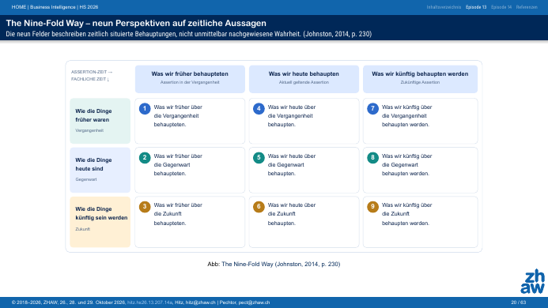

*The Nine-Fold Way nach Johnston (Woche 7)*

## Woche 8: Data Sourcing und Provenance

Data Sourcing beginnt nicht mit einer API, sondern mit einer prüfbaren Evidenzanforderung aus der Data Gap Map. Ein DWH erzeugt keine Evidenz, die an der Quelle nicht beobachtet wurde.

| Modell                             | Was es zeigt                                                                                                                                                                                                       | So wendest du es an                                                       |
|------------------------------------|--------------------------------------------------------------------------------------------------------------------------------------------------------------------------------------------------------------------|---------------------------------------------------------------------------|
| DWH-Referenzmodell (Gansor, Inmon) | Schichten: Quellsysteme → Staging → Core Data Warehouse → Data Marts → Präsentation, dazu Metadaten                                                                                                                | Einordnen können, wo Daten bereinigt und integriert werden.               |
| Data Mesh                          | Dezentrale Datenprodukte pro Domäne mit gemeinsamer Plattform und Governance                                                                                                                                       | Gegenmodell zum zentralen DWH.                                            |
| Sourcing-Prozess (Krasikov)        | 1 Anforderung → 2 Beobachtung → 3 Quellenkandidat → 4 Prüfung                                                                                                                                                      | Immer bei der Gap-ID starten.                                             |
| Begriffe                           | Herkunft (intern, öffentlich, Anbieter, eigene Erhebung) · Erhebungsmethode (Transaktion, Beobachtung, Befragung, Sensorik) · Zugangsweg (API, Export, DB, Stream) · Bereitstellung (roh, aggregiert, synthetisch) | Eine API ist ein Zugangsweg, keine Garantie für eine geeignete Quelle.    |
| Data-Sourcing-Canvas               | Referenz (Gap-ID, IR) · Evidenz (Zielgrösse, Kriterium) · Kandidat (Source-ID, Datenhalter, Methode, Zugang) · Grenzen · Test                                                                                      | Dokumentiert Kandidaten, keine bewilligte Beschaffung.                    |
| Build, Buy, Share, Collect         | Intern erschliessen, einkaufen, in Kooperation tauschen, selbst erheben                                                                                                                                            | Nicht jede Lücke braucht einen Einkauf.                                   |
| Quellenbewertung                   | 1 Muss-Kriterien (rechtmässig, zulässig, plausibel) → 2 Qualität und Validität → 3 Betrieb (Kosten, Aufwand) → 4 Entscheid mit Fallback                                                                            | Ein guter Gesamtscore darf ein verletztes Muss-Kriterium nicht verdecken. |
| Bias-Audit (5 Fragen)              | Zielpopulation? Was fehlt systematisch? Welche Proxys, wann versagen sie? In welche Richtung verzerrt? Welche Zusatzquelle erkennt den Bias?                                                                       | Restrisiken dokumentieren.                                                |
| Datenschutz (4 Fragen)             | Berechtigung, Rechtsgrundlage, Datenminimierung, Folgen                                                                                                                                                            | Technischer Zugriff ist keine Nutzungserlaubnis.                          |
| Provenance Register                | Identifikation (DATA-ID, Gap-ID, Source-ID) · Ursprung · Erzeugung · Bearbeitung · Grenzen                                                                                                                         | Beschreibt einen tatsächlich entstandenen Datenausschnitt.                |

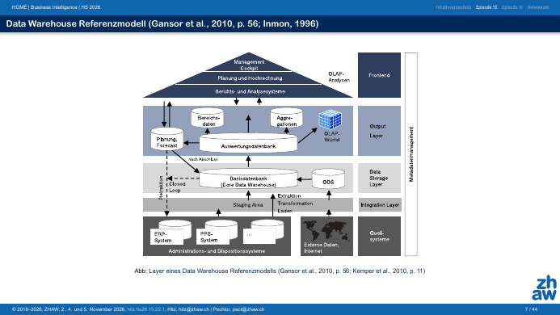

*Data Warehouse Referenzmodell nach Gansor et al. (Woche 8)*

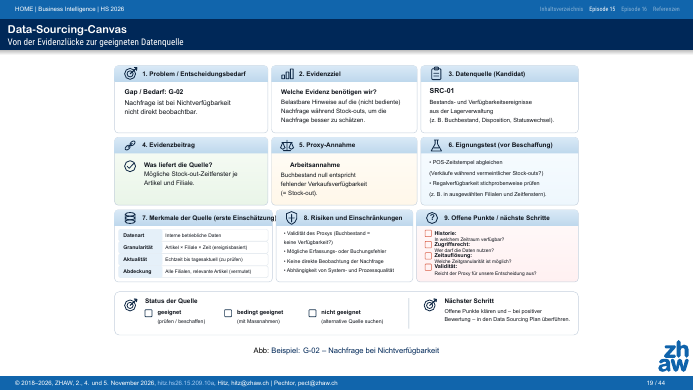

*Data-Sourcing-Canvas am Beispiel G-02 (Woche 8)*

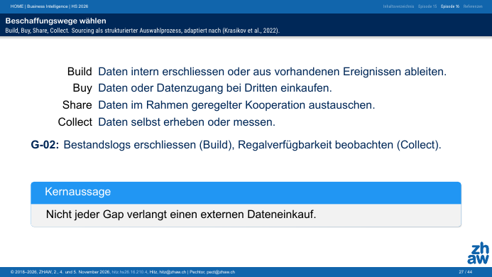

*Beschaffungswege: Build, Buy, Share, Collect (Woche 8)*

**Drei Deliverables:** Data Sourcing Plan mit **mindestens zwei Kandidaten** pro Lücke, Bewertung, Bias-Audit, Auswahl und Fallback · Provenance Register · erster nutzbarer Datenausschnitt. In allen drei dieselbe Gap-ID.

**Achtung:** Synthetische Daten sind Testdaten, keine empirische Evidenz. Beschaffungserfolg und Schliessung der Evidenzlücke sind zwei verschiedene Prüfungen.

### Vertiefung Woche 8

| Thema                         | Kernaussage                                                                                                                                        | Beispiel aus der Vorlesung (G-02, Nachfrage bei Stock-outs)                                                        |
|-------------------------------|----------------------------------------------------------------------------------------------------------------------------------------------------|--------------------------------------------------------------------------------------------------------------------|
| Interne Quellen               | Auch interne Daten sind nur unter dokumentierten Annahmen aussagekräftig. Prüfen: Granularität, Zeitstempel, Schlüssel, Abdeckung, Historisierung. | POS zeigt Verkäufe, aber keine entgangenen Käufe; Lager zeigt Buchbestand, nicht Regalbestand.                     |
| Externe Quellen und Open Data | Verfügbarkeit ist ein Suchkriterium, kein Eignungsnachweis.                                                                                        | Wetter und Feiertage beeinflussen Nachfrage, messen aber keine entgangenen Käufe.                                  |
| API, Datei oder Log           | Datei = Abzug zu einem Zeitpunkt; API = programmatischer Zugriff (Limits, Pagination); Log = Ereignisfolge (Aufbewahrung prüfen)                   | Die Schnittstelle sagt nichts über Messvalidität.                                                                  |
| Mehrere Kandidaten            | Verschiedene Quellen decken verschiedene Teile derselben Lücke ab.                                                                                 | SRC-01 Bestandslog (Stock-out-Zeitfenster), SRC-02 Filialbeobachtung (Regal), SRC-03 Kundenbefragung (Kaufabsicht) |
| Selbst erheben                | Befragung (Recall-Fehler), Interview (Mechanismen, nicht repräsentativ), Beobachtung (Stichprobenplan), Sensorik (Kalibrierung)                    | Erhebungsmethode, Messgrösse und Zielgrösse müssen zusammenpassen.                                                 |
| Synthetische Daten            | Zum Testen von Format, Schnittstelle, Modell und Pipeline. Generator, Annahmen und Parameter dokumentieren.                                        | Simulierte Stock-outs belegen keine realen Nachfragemuster.                                                        |
| Bias-Arten                    | Selection Bias (welche Fälle kommen in die Daten?), Measurement Bias (was misst die Variable?), zeitliche Selektion (fehlen Spitzenzeiten?)        | Unterschätzte Nachfrage führt zu zu tiefen Nachbestellungen.                                                       |
| Datenschutz nach Nissenbaum   | Kontextuelle Integrität: Ein Informationsfluss ist angemessen, wenn er zum Kontext passt, in dem die Daten entstanden sind.                        | Artikel-, Filial- und Zeitangaben reichen; personenbezogene POS-Details sind nicht nötig.                          |
| Datasheet (Gebru)             | Ergänzt Provenance: Wozu entstand der Datensatz, was enthält er, wofür eignet er sich (nicht)?                                                     | Herkunft erklärt den Weg der Daten, Kontext erklärt ihre Grenzen.                                                  |
| Data Mesh (Dehghani)          | Domänen besitzen ihre Daten und stellen sie als Datenprodukte bereit, auf einer gemeinsamen Self-Service-Plattform mit föderaler Governance        | Gegensatz zum zentralen DWH; Datenprodukt-Denken aus Woche 6.                                                      |

**Gesamtablauf Woche 8:** Gap-ID aus der Data Gap Map → Data-Sourcing-Canvas mit Kandidaten → Quellenbewertung mit Muss-Kriterien und Bias-Audit → Datenschutz-Check → Entscheid mit Fallback (Data Sourcing Plan) → Abruf und Provenance Register → erster Datenausschnitt → Evidenzstatus (erfüllt, nicht erfüllt, ungeprüft).

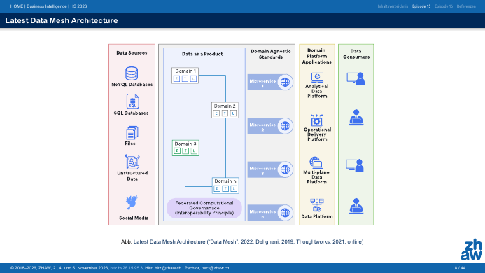

*Data Mesh Architektur (Woche 8)*

## Typische Fehler und worauf ich achten muss

| Fehler                                                        | Besser                                                                                       |
|---------------------------------------------------------------|----------------------------------------------------------------------------------------------|
| «Customer» bei Clark = Kundschaft                             | Customer = Entscheidungsperson, die auf Basis der Analyse handelt                            |
| Kennzahl statt Entscheidung («Wie hoch ist der Umsatz?»)      | Frage, die zu einer benannten Entscheidung einer benannten Rolle führt                       |
| Signal ohne Schwelle («Nachfrage beobachten»)                 | Wenn-dann-Regel mit Zahl, z. B. Wenn Bestand \< 20, dann Charge starten                      |
| Nur Feedback                                                  | Mindestens eine vorausschauende Antwort (Feedforward) mit Störgrösse aus dem Kontextdiagramm |
| Wirkung ohne CLD                                              | System Response entlang der CLD-Pfeile beschreiben, nur erwünschte Wirkung reicht nicht      |
| Unpräzise Adjektive («aktuell», «genau»)                      | Akzeptanzkriterium mit Schwelle, Messmethode und Zeitbezug                                   |
| Dashboard als Handlung                                        | Handlung = was jemand tut, wenn das Dashboard etwas anzeigt                                  |
| «Daten sind vollständig, also gut»                            | Vollständig ist nicht repräsentativ, korrekt ist nicht valide                                |
| «Daten fehlen» als einzige Lücke                              | Gap-Typ benennen: Verfügbarkeit, Validität, Qualität oder Lineage/Zeit                       |
| Jede Lücke mit neuen Daten schliessen                         | Auch verbessern, einschränken, ändern oder verzichten ist eine Massnahme                     |
| API = gute Quelle                                             | Erst Evidenzanforderung, dann Quellenkandidat und Eignungstest                               |
| Profiling-Zahl ohne Nenner                                    | «X von Y Zeilen (Z %), Export vom …, Geltungsbereich …»                                      |
| Nachträglich bekannte Werte (Ist-Wetter) als damaliges Wissen | Prognose zum Entscheidungszeitpunkt speichern (Asserted Versioning)                          |

**Checkliste für jede Antwort im Case:**

- [ ] Ist die Entscheidungsperson eine Rolle aus dem System (nicht die Kundschaft)?

- [ ] Hat jede Frage eine Entscheidung und jede Entscheidung eine IR?

- [ ] Haben Signale und Kriterien einen Schwellenwert mit Einheit?

- [ ] Ist mindestens eine Nebenwirkung genannt?

- [ ] Sind Konstrukt und Proxy getrennt?

- [ ] Ziehen sich dieselben IDs durch alle Artefakte?

## Autorenliste für den Single Choice

| Autor                           | Jahr             | Modell / Beitrag                                         | Woche |
|---------------------------------|------------------|----------------------------------------------------------|-------|
| Luhn                            | 1958             | Business Intelligence System, Ursprung des Begriffs      | 1     |
| Fayyad et al.                   | 1996             | KDD-Prozess                                              | 1     |
| Chapman et al.                  | 2000             | CRISP-DM                                                 | 1     |
| Perkins                         |                  | Learnable Intelligence: neural, experiential, reflective | 1     |
| Racz et al.                     | 2010             | Integral GRC Framework                                   | 1     |
| Moen & Norman                   | 2009             | PDCA-Zyklus (Darstellung)                                | 1     |
| Ashby                           | 1957             | Law of Requisite Variety                                 | 2     |
| Beer                            | 1972, 1979, 1981 | Viable System Model, Cybersyn                            | 2     |
| Ulrich & Probst                 | 1995             | Kompliziert vs. komplex                                  | 2     |
| Ulrich / Dubs                   | 2004             | St. Galler Management-Modell                             | 2     |
| von Foerster                    | 1985             | Triviale und nicht-triviale Maschine                     | 2     |
| Gluchowski                      | 2016             | Ebenen des BI-Verständnisses                             | 2     |
| Gansor et al., Kemper et al.    | 2010             | DWH-Referenzarchitektur                                  | 2, 8  |
| Vennix                          | 1996             | Group Model Building, NGT für Variablen                  | 2     |
| Forrester                       |                  | System Dynamics (Industrial Dynamics 1961), PHAPI        | 3     |
| Deming                          |                  | DMAIC, Six Sigma                                         | 3     |
| Goldratt                        | 1990             | Theory of Constraints, Engpass                           | 3     |
| Clark                           | 2013             | Target-Centric Intelligence Analysis                     | 4, 6  |
| Argyris                         | 1983             | Ladder of Inference                                      | 4     |
| Senge et al.                    | 2011             | The Fifth Discipline                                     | 4     |
| Cao                             | 2018             | Scientific thinking process                              | 4     |
| Ries                            | 2011             | Lean Startup, validiertes Lernen                         | 5     |
| Kimball & Ross                  | 2013             | Data Warehouse Toolkit, Grain, Schlüssel                 | 6, 7  |
| ISO/IEC/IEEE 29148              | 2018             | Requirements Engineering                                 | 6     |
| Gotel & Finkelstein             | 1994             | Traceability                                             | 6     |
| Hasan & Legner                  | 2023             | Data Product Canvas                                      | 6     |
| DAMA DMBOK                      | 2017             | Dateninventar, Data Dictionary, DLM                      | 7     |
| Johnston                        | 2014             | Bitemporal Data, Asserted Versioning, Nine-Fold Way      | 7     |
| Wang & Strong                   | 1996             | Datenqualität aus Nutzersicht                            | 7     |
| ISO/IEC 25012                   | 2008             | Datenqualitätsmodell                                     | 7     |
| Batini & Scannapieco            | 2016             | Datenqualität, Profiling                                 | 7     |
| Borsboom et al.                 | 2004             | Messvalidität                                            | 7     |
| Buneman et al.                  | 2001             | Data Provenance (why and where)                          | 7     |
| Krasikov et al.                 | 2022             | Data-Sourcing-Prozess, Build/Buy/Share/Collect           | 8     |
| Dehghani                        | 2019             | Data Mesh                                                | 8     |
| Gebru et al.                    | 2021             | Datasheets for Datasets                                  | 8     |
| Nissenbaum                      | 2004             | Kontextuelle Integrität (Datenschutz)                    | 8     |
| Suresh & Guttag, Mehrabi et al. | 2021             | Bias-Arten                                               | 8     |
| Shewhart                        |                  | PDCA, Kaizen                                             | 3     |
| Bala et al.                     | 2017             | Elemente von Stock-Flow-Diagrammen                       | 3     |
| Warren                          | 2008             | Akkumulation, Feedback, Verzögerung                      | 3     |
| Barlas & Carpenter              | 1990             | Modellvalidierung: Empiriker vs. Relativist              | 3     |
| Box                             |                  | «All models are wrong, but some are useful»              | 3     |
| Ford                            | 1999             | Bull’s-Eye-Diagramm, Systemgrenze                        | 3     |
| Sweeney & Meadows               | 1996             | Eisbergmodell, Mental Models                             | 3     |
| Osterwalder et al.              | 2005             | Business Model Canvas, Value Proposition Canvas          | 3     |
| Hitz & Schwer                   | 2018             | Dimensionen digitaler Geschäftsmodelle                   | 3     |

## Durchgespielter Case: Bäckerei Müller

So sieht eine vollständige Kette für einen Case aus. Schritte 1 bis 5 und Teile von 6 stammen aus den Vorlesungsbeispielen (Kontextdiagramm, Begleitdokument, Antwortkarte, Mission Brief). Schritte 7 bis 9 sind nach demselben Muster ergänzt und als Vorlage gedacht.

**Ausgangslage:** Zwischen 7 und 9 Uhr sind Croissants regelmässig ausverkauft, am Abend wird Brot entsorgt. Die Inhaberin entscheidet jeden Nachmittag aus Erfahrung, wie viel am nächsten Morgen gebacken wird.

| Schritt | Artefakt                            | Inhalt für die Bäckerei                                                                                                                                                                                                                                                                                                                                                                                      |
|---------|-------------------------------------|--------------------------------------------------------------------------------------------------------------------------------------------------------------------------------------------------------------------------------------------------------------------------------------------------------------------------------------------------------------------------------------------------------------|
| 1       | System Charter                      | Zweck: Backwaren produzieren und verkaufen. Systemgrenze: ein Laden mit Backstube; Lieferanten und Behörden ausserhalb. Stakeholder: Inhaberin, Verkaufsteam, Stammkundschaft. Entscheidungen: Backmenge pro Tag, Zusatzcharge am Morgen, Personaleinsatz. Grundlage heute: Erfahrung.                                                                                                                       |
| 2       | Kontextdiagramm                     | Kundschaft (Bestellungen, Nachfrage ↔ Backwaren), Lieferanten (Mehl, Hefe), Mitarbeitende, Behörden, Gemeinde (Anlässe wie Dorffest), Konkurrenz, Umwelt (Wetter)                                                                                                                                                                                                                                            |
| 3       | CLD und Stock-Flow                  | R1 Empfehlung, B1 Bestandsregelung, B2 Grenzen des Wachstums, Verzögerung 5 Tage bei der erwarteten Grundnachfrage, Störgrösse Dorffest, Engpass Backkapazität 800 Stück/Tag                                                                                                                                                                                                                                 |
| 4       | BOT                                 | Variable: täglich entgangener Verkauf. Ohne Intervention: Spitzen an Festtagen und Wochenenden. Mit Feedforward: Spitzen verschwinden.                                                                                                                                                                                                                                                                       |
| 5       | Antwortkarte                        | Entscheidungsperson: Inhaberin. Entscheidung: festlegen, ob vor 7 Uhr eine Zusatzcharge gebacken wird. Schlüsselfrage: Reicht der Bestand für die Nachfrage 7 bis 9 Uhr? Antwort: Prognose Bestand um 7 Uhr vs. Nachfrage, täglich. Bezug: Bestand «Backwaren im Laden», Fluss «Verkauf», Störgrösse Wetter. Lücke: verlorene Nachfrage unbekannt.                                                           |
| 6       | Actionable Signal und Impact        | Signal: Wenn erwarteter Bestand um 7 Uhr \< 20, dann Zusatzcharge (Feedforward). Response: weniger leere Regale, mehr Arbeit am Morgen. Folgen: mehr Umsatz, aber mehr Abfall bei tiefer Nachfrage.                                                                                                                                                                                                          |
| 7       | Wirkungshypothese und Mission Brief | Wenn Zusatzcharge bei Signal, dann weniger Tage mit leeren Regalen, weil Verfügbarkeit → weniger Abwanderung (B2). Widerlegt, wenn nach 4 Wochen kein Rückgang. Erster Schritt: 4 Wochen Strichliste «ausverkauft um … Uhr», ca. 300 Franken für Datenexport.                                                                                                                                                |
| 8       | IR und Traceability                 | IR-01: Vor 6:30 Uhr liegt für jeden Tag eine Prognose der Croissant-Nachfrage 7 bis 9 Uhr mit Spanne vor. Akzeptanz: GEGEBEN Werktag, WENN 6:30 Uhr, DANN Prognose mit Zeitstempel verfügbar, an ≥ 95 % der Tage, geprüft per Log. Traceability: S-01 Verfügbarkeit sichern → Q-01 Reicht der Bestand? → D-01 Zusatzcharge? → IR-01 → DP-01 Morgenprognose → A-01 Charge backen → W-01 weniger leere Regale. |
| 9       | Data Gap Map                        | Konstrukt: Nachfrage. Proxy: Verkäufe aus der Kasse. Versagt bei Ausverkauf. E-01 Verkäufe pro Stunde vorhanden: erfüllt. E-02 Nachfrage bei Ausverkauf schätzbar: nicht erfüllt → G-01 Validität, hoch. E-03 Bestand um 7 Uhr rückwirkend bekannt: nicht erfüllt → G-02 Zeit, mittel.                                                                                                                       |
| 10      | Data Sourcing und Provenance        | G-01: Kandidat A Strichliste «ausverkauft um» (Collect), Kandidat B Kassenzeitpunkt des letzten Verkaufs (Build). Bias: Laufkundschaft ohne Kauf bleibt unsichtbar. Datenschutz: keine Personendaten nötig. Fallback: Verkaufsteam notiert auf Papier. Provenance: DATA-01, G-01, SRC-A, Verkaufsteam, täglich, intern.                                                                                      |

**Wie du das im Case nutzt:** Die Spalte «Artefakt» ist deine Gliederung. Für jeden Schritt reichen zwei bis vier Sätze, solange die IDs durchlaufen.

## Übungsfragen im Prüfungsstil

**Single Choice (Antwort in der rechten Spalte):**

| Nr. | Frage                                                                                           | Antwort                                                                                                                            |
|-----|-------------------------------------------------------------------------------------------------|------------------------------------------------------------------------------------------------------------------------------------|
| 1   | Wer meint Clark mit «customer»?                                                                 | Die Person, die auf Basis der Analyse entscheidet, nicht die Kundschaft                                                            |
| 2   | Eine Schleife hat zwei − Pfeile. Ist sie R oder B?                                              | R (gerade Anzahl −)                                                                                                                |
| 3   | Welches VSM-System ist «Aussen und Dann»?                                                       | System 4                                                                                                                           |
| 4   | Welches VSM-System ist der Auditkanal?                                                          | System 3\*                                                                                                                         |
| 5   | Was besagt Ashbys Gesetz?                                                                       | Nur Varietät kann Varietät absorbieren                                                                                             |
| 6   | Feedback oder Feedforward: Die Bäckerei bestellt wegen eines angekündigten Dorffests mehr Mehl. | Feedforward                                                                                                                        |
| 7   | Was ist der Unterschied zwischen Informations- und Datenanforderung?                            | IR: welche Aussage möglich sein muss. Datenanforderung: welche Daten mit welchen Eigenschaften. Frage 5 bleibt technologieneutral. |
| 8   | Was bedeutet «Korrektheit ist nicht Validität»?                                                 | Ein Wert kann korrekt gemessen sein (12 Verkäufe), die Interpretation (Nachfrage = 12) trotzdem falsch                             |
| 9   | Nenne die vier Gap-Typen.                                                                       | Verfügbarkeit, Validität, Qualität, Lineage/Zeit                                                                                   |
| 10  | Welche vier Zeitstempel kennt Asserted Versioning?                                              | effective from/to, asserted from/to                                                                                                |
| 11  | Was steht im Nine-Fold Way in Feld 6?                                                           | Was wir heute über die Zukunft behaupten (Forecast)                                                                                |
| 12  | Nenne die vier Beschaffungswege nach Krasikov.                                                  | Build, Buy, Share, Collect                                                                                                         |
| 13  | Was gilt bei der Quellenbewertung zuerst?                                                       | Muss-Kriterien (rechtmässig, zulässig, plausibel); ein guter Gesamtscore darf ein verletztes Muss-Kriterium nicht verdecken        |
| 14  | Sind synthetische Daten Evidenz?                                                                | Nein, nur Testdaten für Format, Pipeline und Modell                                                                                |
| 15  | Welche drei Regeln gelten für den BI Mission Brief?                                             | Lesertest, Herkunft, kleiner Auftrag                                                                                               |
| 16  | Was ist der Unterschied zwischen kompliziert und komplex?                                       | Kompliziert: viele, verschiedene Elemente und Beziehungen. Komplex: Veränderlichkeit im Zeitablauf.                                |
| 17  | Welche drei Dimensionen prüft der Data Product Canvas?                                          | Desirability, Feasibility, Viability                                                                                               |
| 18  | Wer hat den Begriff Business Intelligence 1958 geprägt?                                         | Luhn                                                                                                                               |
| 19  | Wofür steht PHAPI?                                                                              | Problem, Hypotheses, Analyses, Policy design, Implementation (Forrester)                                                           |
| 20  | Wodurch wird ein Bestand verändert?                                                             | Nur durch Flüsse. Ein Informationspfeil zeigt nie in einen Bestand.                                                                |
| 21  | Was ist das primäre Ziel von System Dynamics?                                                   | Erklären und Verständnis, keine Voraussage; Struktur bestimmt Verhalten                                                            |
| 22  | White-Box- oder Black-Box-Validierung: Die Struktur des Modells entspricht der des Systems.     | White-Box                                                                                                                          |
| 23  | Was ist der erste Schritt der Theory of Constraints?                                            | Den Engpass identifizieren                                                                                                         |
| 24  | Was steht im Bull’s-Eye-Diagramm im innersten Kreis?                                            | Endogene Variablen (vom Modell erklärt)                                                                                            |

**Case-Übung zum Selbermachen:** Nimm ein System, das du kennst, zum Beispiel einen Coiffeursalon (Terminbuchung, Personal am Samstag, Laufkundschaft) oder einen Sportverein (Trainingsplanung, Hallenbelegung). Spiele in 60 Minuten die zehn Schritte aus dem Bäckerei-Case durch. Kontrolliere am Ende mit der Checkliste oben, ob jede Zeile auf eine Entscheidung zurückführt.
