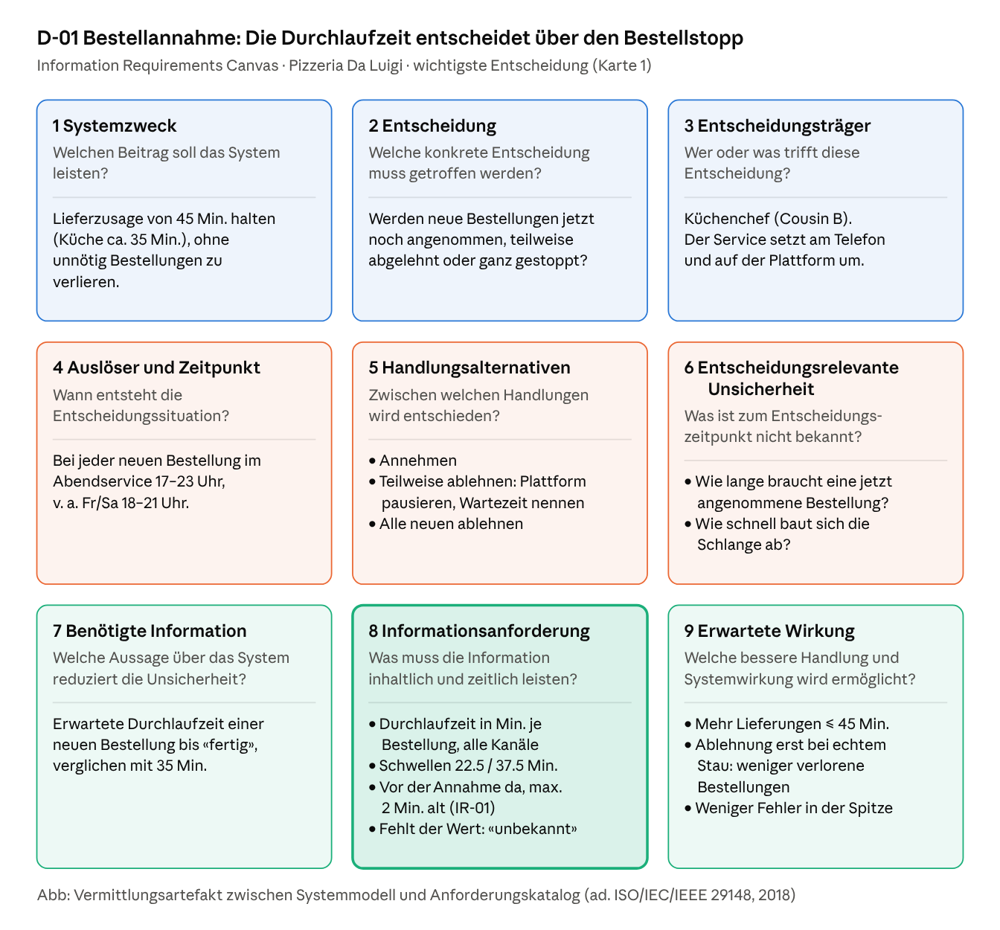
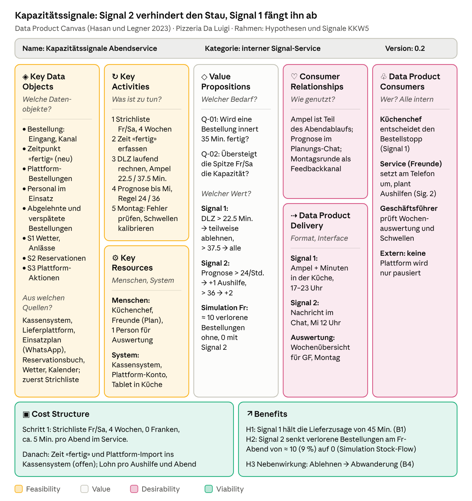

# Pizzeria_Da_Luigi_Woche6

# Pizzeria Da Luigi – Woche 6: Von der Entscheidung zum Datenprodukt

Oct 22, 2026 · @Lara Bangerter

## 0 Eingang: Systemmodell, Decision Context Cards, Mission Brief

Die Kette übersetzt unsere drei Antwortkarten aus Woche 5 in prüfbare Informationsanforderungen; nichts davon legt schon Datenquelle, Algorithmus oder Interface fest (Frage 5, nicht Frage 6). Grundlage sind Charter V2, CLD (finished), Stock-Flow (einfach) und die Präsentation KKW5.

**Target (Clark):** Der Bestellfluss der Pizzeria Da Luigi in der Abendspitze Fr/Sa 18–21 Uhr – vom Bestelleingang (Telefon, vor Ort, Lieferplattform) über Küche und Ofen bis zur Übergabe an die Lieferung, mit dem eingesetzten Personal als Engpass.

**Systemzweck und IDs für die Traceability**

| ID   | Systemzweck                                                                                                                 | Herkunft                                 |
|------|-----------------------------------------------------------------------------------------------------------------------------|------------------------------------------|
| S-01 | Lieferzusage von 45 Min. ab Bestellung auch in der Spitze einhalten (Küche ca. 35 Min.)                                     | Charter 1                                |
| S-02 | Nachfrage halten und den Familienbetrieb wirtschaftlich erhalten: keine unnötig abgelehnten Bestellungen, keine Abwanderung | Charter 1, CLD «Abgelehnte Bestellungen» |
| S-03 | Vorbereitung ohne Verschwendung: genug Teig, wenig Rest                                                                     | Charter 4, CLD «Vorbereitete Teigmenge»  |

**Entscheidungen aus den Decision Context Cards**

| Karte      | BI-Frage                                                                                     | Entscheidung                                                        | Wer                   | Art         |
|------------|----------------------------------------------------------------------------------------------|---------------------------------------------------------------------|-----------------------|-------------|
| 1 (Rang 1) | Q-01: Wird eine jetzt angenommene Bestellung innerhalb der Lieferzusage fertig?              | D-01: Ab wann werden neue Bestellungen abgelehnt?                   | Küchenchef (Cousin B) | Feedback    |
| 2          | Q-02: Übersteigt die erwartete Spitzennachfrage Fr/Sa die Kapazität des geplanten Personals? | D-02: Wie viele Aushilfen werden bis Mittwoch für Fr/Sa eingeplant? | Freunde (Service)     | Feedforward |
| 3          | Q-03: Reicht der Teig für die erwartete Nachfrage, ohne viel Rest?                           | D-03: Wie viel Teig wird am Vortag angesetzt?                       | Küchenchef (Cousin B) | Feedforward |

**Aus dem Mission Brief:** Karte 1 ist die wichtigste; ihr Signal lautet «Durchlaufzeit \> 22.5 Min. → Ablehnung beginnt, ab 37.5 Min. alle». Der Bestellstopp behandelt das Symptom, die Ursache (zu wenig Personal in der Spitze) adressiert Karte 2.

## 1 Information Requirements Canvas

Jede der drei Entscheidungen führt über die neun Canvas-Felder zu einer lösungsneutralen Informationsanforderung; Karte 1 ist ausgearbeitet, 2 und 3 nutzen dieselbe Nachfrageprognose.

Information Requirements Canvas · D-01 Bestellannahme

| Feld                                  | D-01 Bestellannahme                                                                                              | D-02 Wochenend-Einsatzplan                                                                                                          | D-03 Teigmenge                                                  |
|---------------------------------------|------------------------------------------------------------------------------------------------------------------|-------------------------------------------------------------------------------------------------------------------------------------|-----------------------------------------------------------------|
| 1 Systemzweck                         | S-01 Lieferzusage halten, S-02 Nachfrage halten                                                                  | S-01, S-02                                                                                                                          | S-03 wenig Verschwendung, S-02                                  |
| 2 Entscheidung                        | Werden neue Bestellungen jetzt noch angenommen, teilweise abgelehnt oder ganz gestoppt?                          | Wie viele Aushilfen (0, 1, 2) werden für Fr/Sa-Abend eingeplant?                                                                    | Wie viel Teig wird für morgen angesetzt?                        |
| 3 Entscheidungsträger                 | Küchenchef (Cousin B); Service setzt am Telefon um                                                               | Freunde (Service)                                                                                                                   | Küchenchef (Cousin B)                                           |
| 4 Auslöser und Zeitpunkt              | Laufend im Abendservice 17–23 Uhr, v. a. Fr/Sa; bei jeder neuen Bestellung                                       | Wöchentlich, Entscheid bis Mittwoch, damit Aushilfen zusagen können                                                                 | Täglich am Vortag, vor dem Ansetzen (Teig braucht Ruhezeit)     |
| 5 Handlungsalternativen               | Annehmen · teilweise ablehnen (Plattform pausieren, längere Wartezeit nennen) · alle ablehnen                    | Keine · eine · zwei zusätzliche Aushilfen                                                                                           | Standardmenge · mehr · weniger                                  |
| 6 Entscheidungsrelevante Unsicherheit | Wie lange dauert eine jetzt angenommene Bestellung bis «fertig»? Wie schnell baut sich die Schlange ab?          | Wie hoch wird die Spitzennachfrage Fr/Sa 18–21 Uhr? Welche Störgrössen (Wetter, Anlässe, Reservationen, Plattform-Aktionen) wirken? | Wie viele Pizzen werden morgen bestellt?                        |
| 7 Benötigte Information               | Erwartete Durchlaufzeit einer neuen Bestellung im Vergleich zur Küchenzeit von 35 Min.                           | Erwartete Bestellungen pro Stunde Fr/Sa 18–21 Uhr (Spanne tief/hoch) im Vergleich zur Kapazität des geplanten Personals             | Erwartete Pizzen für morgen im Vergleich zur Standard-Teigmenge |
| 8 Informationsanforderung             | IR-01 (+ IR-02 Ablehnungen)                                                                                      | IR-03 (+ IR-04 Prognosefehler)                                                                                                      | IR-05                                                           |
| 9 Erwartete Wirkung                   | W-01 Lieferzusage gehalten; W-02 weniger verlorene Bestellungen, weil die Ablehnung erst bei echtem Stau startet | W-01 weniger Stau in der Spitze; W-03 weniger Ablehnungen, weil die Ursache vorher behoben wird                                     | W-04 weniger Teigrest und kein Ausverkauf                       |

Die Prognose für D-02 und D-03 ist dieselbe Information in zwei Granularitäten (Bestellungen pro Stunde vs. Pizzen pro Tag) – im Katalog deshalb organisationsweit wiederverwendbar, nicht doppelt.

## 2 Information Requirements Catalogue v1

Fünf Anforderungen decken alle drei Entscheidungen ab; IR-02 und IR-04 kommen dazu, weil sonst Nebenwirkung (B1) und Prognosegüte nicht prüfbar wären.

| ID    | Ebene                              | Nutzerrolle                            | Entscheidung                   | Benötigte Information                                                                                                                                                                             | Auslöser                        | Frequenz                        | Gewünschte Darstellung (vorläufig)                      | Erwartete Handlung                                                      | Herkunft                |
|-------|------------------------------------|----------------------------------------|--------------------------------|---------------------------------------------------------------------------------------------------------------------------------------------------------------------------------------------------|---------------------------------|---------------------------------|---------------------------------------------------------|-------------------------------------------------------------------------|-------------------------|
| IR-01 | Rollenbezogen                      | Küchenchef; Service                    | D-01 Bestellannahme            | Vor jeder Annahme muss erkennbar sein, ob eine jetzt angenommene Bestellung innerhalb der Küchenzeit von 35 Min. fertig wird (erwartete Durchlaufzeit gegen Schwellen 22.5 / 37.5 Min.)           | Neue Bestellung im Abendservice | Laufend 17–23 Uhr               | Ampel grün/gelb/rot am Arbeitsplatz Küche, Wert in Min. | Annehmen, Plattform pausieren / längere Wartezeit nennen, alle ablehnen | Karte 1, Signal KKW5    |
| IR-02 | Organisationsweit                  | Geschäftsführer (Cousin A); Küchenchef | D-01 Schwellen überprüfen      | Wie viele Bestellungen pro Abend abgelehnt wurden und wie viele davon zu spät geliefert wurden, je Kanal                                                                                          | Ende Abendservice               | Täglich, Auswertung wöchentlich | Wochenübersicht                                         | Schwellen 22.5 / 37.5 Min. anpassen                                     | Karte 1, Consequences   |
| IR-03 | Organisationsweit wiederverwendbar | Freunde (Service)                      | D-02 Einsatzplan               | Bis Mittwoch muss für Fr und Sa 18–21 Uhr erkennbar sein, ob die erwarteten Bestellungen pro Stunde (Spanne tief/hoch) die Kapazität des geplanten Personals (24/Std. bei 2 Personen) übersteigen | Wöchentliche Planung            | Wöchentlich, bis Mi 12 Uhr      | Kurze Nachricht in den Planungs-Chat                    | 0, 1 oder 2 Aushilfen einplanen (Schwellen 24 / 36)                     | Karte 2                 |
| IR-04 | Organisationsweit                  | Freunde; Geschäftsführer               | D-02, D-03 Prognose vertrauen? | Abweichung Prognose gegen tatsächliche Bestellungen der Vorwoche                                                                                                                                  | Montag                          | Wöchentlich                     | Vergleichszeile pro Tag                                 | Faktoren (Wetter, Anlass, Aktion) nachkalibrieren                       | Karte 2, Kontrolle KKW5 |
| IR-05 | Rollenbezogen                      | Küchenchef                             | D-03 Teigmenge                 | Am Vortag muss erkennbar sein, ob die erwartete Zahl Pizzen für morgen die Standard-Teigmenge über- oder unterschreitet                                                                           | Vor dem Ansetzen des Teigs      | Täglich                         | Eine Zahl + Abweichung zur Standardmenge                | Mehr, Standard oder weniger Teig ansetzen                               | Karte 3                 |

Die Spalte «Darstellung» ist bewusst vorläufig: Frage 5 legt nur fest, *was* bekannt sein muss; Form und Technik folgen ab Frage 6.

## 3 Spezifikation, Qualitäts- und Serviceanforderungen

Qualität richtet sich nach der Entscheidung: IR-01 braucht Minuten-Aktualität, IR-03 und IR-05 genügen einmal pro Woche bzw. Tag – Echtzeit wäre dort nur teurer.

**Funktional vs. nichtfunktional (IR-01)**

- Funktional: Für jede neue Bestellung wird die erwartete Durchlaufzeit bis «fertig» in Minuten geliefert.

- Nichtfunktional: Der Wert liegt vor, bevor die Bestellung angenommen wird; Schwellen und Rechenstand sind nachvollziehbar; fehlt der Wert, ist das sichtbar.

**Spezifikation je Anforderung**

| Eigenschaft                | IR-01 Durchlaufzeit                                                                                                                 | IR-02 Ablehnungen                                                                                                  | IR-03 Spitzenprognose                                                | IR-04 Prognosefehler                           | IR-05 Pizzen morgen                                  |
|----------------------------|-------------------------------------------------------------------------------------------------------------------------------------|--------------------------------------------------------------------------------------------------------------------|----------------------------------------------------------------------|------------------------------------------------|------------------------------------------------------|
| Semantik                   | «Durchlaufzeit» = Minuten von Bestelleingang bis Zeitpunkt «fertig» in der Küche, ohne Lieferweg. Erwartungswert, keine Beobachtung | «Abgelehnt» = Bestellung nicht angenommen oder Plattform pausiert; «zu spät» = Übergabe nach 45 Min. ab Bestellung | Bestellungen (nicht Pizzen) aller Kanäle pro Stunde, inkl. Plattform | Prognose minus Ist, in Bestellungen/Std. und % | Pizzen (nicht Bestellungen) aller Kanäle pro Tag     |
| Granularität               | Je Bestellung, alle Kanäle zusammen                                                                                                 | Je Abend und Kanal                                                                                                 | Je Stunde, Fr und Sa 18–21 Uhr                                       | Je Tag                                         | Je Tag                                               |
| Zeit                       | Ereigniszeit = Bestelleingang; bereitgestellt vor Annahme; gültig bis zur nächsten Bestellung                                       | Nach Service-Ende                                                                                                  | Bereit bis Mi 12 Uhr; gültig für das kommende Wochenende             | Jeden Montag für die Vorwoche                  | Bereit am Vortag vor dem Teigansetzen                |
| Max. Alter                 | 2 Min.                                                                                                                              | 1 Tag                                                                                                              | 2 Tage (neue Reservationen nachtragen)                               | 1 Woche                                        | 1 Tag                                                |
| Genauigkeit / Unsicherheit | ± 5 Min. tolerierbar, weil die Schwellen 15 Min. Abstand haben                                                                      | Exakte Zählung                                                                                                     | Als Spanne tief/hoch, nicht als Punktwert                            | Wird selbst gemessen                           | Als Spanne; Fehlbestand (Ausverkauf) teurer als Rest |
| Zugriff                    | Küche und Service während des Service                                                                                               | Geschäftsführer, Küchenchef                                                                                        | Freunde, Geschäftsführer                                             | Freunde, Geschäftsführer                       | Küchenchef                                           |
| Ausfallverhalten           | Kein Wert → Status «unbekannt», Küchenchef entscheidet nach Augenschein wie heute                                                   | Fehlt ein Abend → als Lücke markiert                                                                               | Keine Prognose → Vorwochenwert + Hinweis                             | —                                              | Keine Prognose → Standardmenge                       |

**Berechnungs- und Kontrollformeln**

Die Formeln machen die Anforderungen prüfbar; Faktoren und Zeiten sind Annahmen, die nach 4 Wochen mit Kassendaten kalibriert werden.

IR-01 Erwartete Durchlaufzeit einer neuen Bestellung (Kapazität 12 Bestellungen pro Person und Stunde):

**Erwartete Durchlaufzeit (Min.) = (Offene Bestellungen × 60) ÷ (Personal im Einsatz × 12) + Zubereitungs- und Backzeit (ohne Stau 20 Min.)**

Signal: DLZ unter 22.5 Min. = annehmen (grün), 22.5 bis 37.5 Min. = teilweise ablehnen (gelb), über 37.5 Min. = alle ablehnen (rot). Ohne Stau beträgt die Durchlaufzeit laut Stock-Flow v8 20 Min.; dieser Wert wird mit der erfassten Zeit «fertig» überprüft.

IR-03 Spitzenprognose Fr/Sa 18–21 Uhr, je Stunde, als Spanne tief/hoch:

**Prognose (Bestellungen/Std.) = Ø Basis letzte 4 Wochen × Wetterfaktor × Anlassfaktor + Reservationen + Aktionszuschlag**

Regel: Prognose (hoch) über 24 Bestellungen/Std. = 1 Aushilfe mehr, über 36 = 2 (24 = 2 Personen × 12).

IR-05 Pizzen für morgen (Pizzen pro Bestellung aus dem Kassensystem):

**Pizzen morgen = Prognose Bestellungen pro Tag × Ø Pizzen pro Bestellung**

IR-04 Kontrollformel, jeden Montag pro Tag der Vorwoche:

**Prognosefehler (%) = (Ist − Prognose) ÷ Ist × 100**

Kontrolle IR-01 nach 4 Wochen: Anteil Bestellungen mit \|DLZ erwartet − DLZ gemessen\| ≤ 5 Min. muss mindestens 80 % betragen.

**Akzeptanzkriterien (GEGEBEN – WENN – DANN)**

1.  **IR-01:** GEGEBEN Abendservice Fr/Sa WENN eine neue Bestellung eingeht DANN ist innerhalb von 1 Min. eine erwartete Durchlaufzeit mit Zeitstempel sichtbar, mit Schwellenwert Abweichung zur gemessenen Durchlaufzeit ≤ 5 Min. bei 80 % der Bestellungen, gemessen durch Vergleich mit der erfassten Zeit «fertig» über 4 Wochen, bei Verstoss Schwellen nicht automatisch anwenden und im Team überprüfen.

2.  **IR-01 Ausfall:** GEGEBEN keine Durchlaufzeit berechenbar WENN eine Bestellung eingeht DANN wird «unbekannt» angezeigt statt eines Ersatzwerts, gemessen durch Test mit fehlender Zeit «fertig», bei Verstoss Anzeige sperren.

3.  **IR-02:** GEGEBEN Service-Ende WENN der Tag abgeschlossen wird DANN sind Ablehnungen und verspätete Lieferungen je Kanal gezählt, mit Schwellenwert 100 % der Abende im Zeitraum, gemessen durch Wochenübersicht, bei Verstoss Lücke markieren.

4.  **IR-03:** GEGEBEN Planungswoche WENN Mittwoch 12 Uhr DANN liegt für Fr und Sa 18–21 Uhr je eine Spanne tief/hoch vor, mit Schwellenwert Ist innerhalb der Spanne an 3 von 4 Abenden, gemessen durch IR-04 über 4 Wochen, bei Verstoss Faktoren kalibrieren.

5.  **IR-05:** GEGEBEN Vortag WENN der Teig angesetzt wird DANN liegt eine Prognose Pizzen für morgen vor, mit Schwellenwert Abweichung ≤ 15 % an 4 von 5 Tagen, gemessen durch Vergleich mit verkauften Pizzen, bei Verstoss Standardmenge verwenden.

Alle Zahlen (2 Min., ± 5 Min., 80 %, 15 %) sind begründete Annahmen und werden nach 4 Wochen mit Daten fachlich vereinbart, nicht festgeschrieben.

## 4 Traceability Matrix

Jede Anforderung lässt sich auf einen Systemzweck und eine Entscheidung zurückführen; jede Wirkung hat eine Beobachtung, die sie widerlegen würde.

| Zweck                    | BI-Frage                    | Entscheidung        | Information                        | Handlung                       | Wirkung                                      | Geplantes Datenprodukt (Vorschlag) | Evidenzstatus                                                         |
|--------------------------|-----------------------------|---------------------|------------------------------------|--------------------------------|----------------------------------------------|------------------------------------|-----------------------------------------------------------------------|
| S-01 Lieferzusage        | Q-01 Fertig innert 35 Min.? | D-01 Bestellannahme | IR-01 Erwartete Durchlaufzeit      | Plattform pausieren / ablehnen | W-01 Anteil Lieferungen ≤ 45 Min. steigt     | DP-01 Signal 1 (Kapazitätssignale) | Hypothese; Zeit «fertig» heute nicht erfasst                          |
| S-02 Nachfrage halten    | Q-01                        | D-01 Schwellen      | IR-02 Ablehnungen und Verspätungen | Schwellen anpassen             | W-02 Verlorene Bestellungen pro Abend sinken | DP-01 (Tagesauswertung)            | Hypothese                                                             |
| S-01, S-02               | Q-02 Spitze \> Kapazität?   | D-02 Einsatzplan    | IR-03 Spitzenprognose              | 0/1/2 Aushilfen einplanen      | W-03 Weniger Abende mit Bestellstopp         | DP-02 Signal 2 (Kapazitätssignale) | Simulation: ≈ 10 → 0 verlorene Bestellungen; Einsatzplan nur WhatsApp |
| S-01, S-02, S-03         | Q-02, Q-03                  | D-02, D-03          | IR-04 Prognosefehler               | Faktoren kalibrieren           | Voraussetzung für W-03, W-04                 | DP-02                              | Offen                                                                 |
| S-03 Wenig Verschwendung | Q-03 Teig reicht?           | D-03 Teigmenge      | IR-05 Pizzen morgen                | Mehr / weniger Teig            | W-04 Weniger Teigrest, kein Ausverkauf       | DP-02 (Tagessicht)                 | Hypothese; Teigrest heute nicht erfasst                               |

**Wirkungshypothesen und was sie widerlegen würde**

- **W-01:** Wenn der Küchenchef ab 22.5 Min. ablehnt, steigt der Anteil pünktlicher Lieferungen, weil «Auslastung Küche» → «Lieferzeit» sinkt (B1). Widerlegt, wenn nach 4 Wochen der Anteil ≤ 45 Min. nicht steigt.

- **W-02 (Nebenwirkung):** Ablehnen erhöht «Abgelehnte Bestellungen» und über S6 die Abwanderung (B4). Widerlegt als Risiko, wenn Ablehnungen pro Abend nicht steigen; problematisch, wenn sie stärker steigen als die Verspätungen sinken.

- **W-03:** Wenn bei Prognose \> 24/Std. eine Aushilfe kommt, gibt es weniger Bestellstopps, weil «Personal im Einsatz» die Kapazität erhöht (B3). In der Simulation sinken die verlorenen Bestellungen am Freitagabend von ≈ 10 (9 %) auf 0. Widerlegt, wenn Abende mit Stopp trotz Aushilfe gleich bleiben (dann ist der Ofen der Engpass, nicht das Personal).

- **W-04:** Wenn der Teig nach Prognose angesetzt wird, sinkt der Rest ohne Ausverkauf. Widerlegt, wenn Ausverkauf häufiger wird.

**Vorwärtsprüfung (vom Zweck):** S-01, S-02 und S-03 haben je mindestens eine Anforderung; keine Lücke. Offen: Für die konkurrierende Erklärung «Ofen statt Personal ist der Engpass» gibt es noch keine Anforderung.

**Rückwärtsprüfung (von der Anforderung):** IR-01, IR-03, IR-05 stützen je eine Entscheidung direkt. IR-02 und IR-04 stützen keine operative Entscheidung, sondern die Überprüfung von Schwellen und Prognose – begründet, weil sonst W-01 bis W-04 nicht prüfbar wären. IR-03 und IR-05 nutzen dieselbe Prognose; das ist Wiederverwendung, keine Doppelung.

Die Matrix zeigt eine Begründungskette, keinen Beweis, dass die Information die Handlung verbessert.

## 5 Data Product Canvas: Kapazitätssignale Abendservice

Das Datenprodukt bündelt beide Signale aus der Präsentation – Signal 1 Bestellstopp (DP-01, IR-01/02) und Signal 2 Aushilfen nach Prognose (DP-02, IR-03/04) – und begründet seinen Nutzen mit den Hypothesen H1–H3. Begründbar sind in Woche 6 Consumers und Value; Daten, Aktivitäten und Kosten sind Hypothese oder offen.

Data Product Canvas · Kapazitätssignale Abendservice

Karte 3 (Teig) ist bewusst nicht Teil dieses Datenprodukts: Die Präsentation legt dafür noch kein Signal fest; IR-05 nutzt nur dieselbe Prognose.

**Kritische Reflexion (Beer System 4/5):** Die Ampel kann erwünscht, machbar und günstig sein und trotzdem dem Gesamtsystem schaden: Sie optimiert das Symptom (Stau) und kann die Ursache (zu wenig Personal) verdecken, wenn häufiges Ablehnen zur Normalität wird. Deshalb enthält das Datenprodukt auch Signal 2, das die Ursache vorab behebt, und W-02 / H3 wird als Nebenwirkung überwacht.

## 6 Review-Checkliste und offene Punkte

Der Selbsttest besteht für IR-01 und IR-03; die Schwachstellen liegen bei IR-05 (Standardmenge fehlt) und bei Begriffen, die CLD und Stock-Flow verschieden nennen.

| Kriterium   | IR-01                                                    | IR-02                 | IR-03     | IR-04                | IR-05                          |
|-------------|----------------------------------------------------------|-----------------------|-----------|----------------------|--------------------------------|
| Eindeutig   | Ja                                                       | Ja                    | Ja        | Ja                   | Teilweise: Standardmenge fehlt |
| Notwendig   | Ja (D-01)                                                | Ja (Schwellen prüfen) | Ja (D-02) | Ja (Prognose prüfen) | Ja (D-03)                      |
| Vollständig | Ja                                                       | Ja                    | Ja        | Ja                   | Zeitpunkt Teigansetzen offen   |
| Prüfbar     | Ja                                                       | Ja                    | Ja        | Ja                   | Ja                             |
| Konsistent  | Name «Lieferzeit» (CLD) vs. «Durchlaufzeit» (Stock-Flow) | Ja                    | Ja        | Ja                   | Ja                             |
| Angemessen  | Ja, Strichliste zuerst                                   | Ja                    | Ja        | Ja                   | Ja                             |

**Fragen für den Peer Review**

- Würde eine andere Antwort auf IR-02 die Schwellen wirklich ändern, oder ist sie nur «nice to know»?

- Welche Verzögerung macht IR-01 wertlos – reichen 2 Min.?

- Was würde zeigen, dass der Ofen und nicht das Personal der Engpass ist?

**Offen fürs Team**

- [ ] Standard-Teigmenge und Zeitpunkt des Ansetzens beim Küchenchef klären (IR-05)

- [ ] «Lieferzeit» im CLD und «Erwartete Durchlaufzeit» im Stock-Flow angleichen

- [ ] Annahmen 2 Min., ± 5 Min., 80 %, 15 % im Team bestätigen

- [ ] Entscheiden, ob eine IR für die Ofenkapazität nötig ist (Vorwärtsprüfung)

- [ ] Antwortkarten-Dokument auf Stand KKW5 bringen (2 Personen, 24/Std.)
