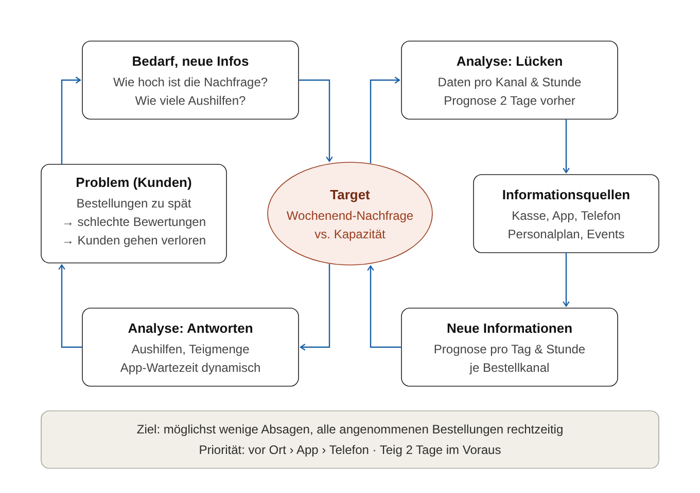

# abgabewoche7

# Intelligence-Analyse: Target-centric Approach – Restaurant

Wochenendnachfrage und Kapazitätsplanung nach dem Modell von Clark (2013)

**Ausgangsproblem**

Am Wochenende ist die Nachfrage hoch und schwer vorherzusagen. Kommen wir mit den Bestellungen nicht nach, werden sie zu spät fertig oder müssen abgelehnt werden. Verspätete Bestellungen führen zu schlechten Bewertungen, und schlechte Bewertungen kosten uns künftige Kunden. Das eigentliche Risiko ist also nicht eine einzelne verlorene Bestellung, sondern der langfristige Verlust von Kunden.

*Abb.: Intelligence analysis: a target-centric approach, angewendet auf das Restaurant (nach Clark, 2013)*

# Information Requirements Canvas – Restaurant

Informationsbedarf für die Wochenendplanung (Teig, Aushilfen, Annahme von Bestellungen)

<table>
<colgroup>
<col style="width: 33%" />
<col style="width: 33%" />
<col style="width: 33%" />
</colgroup>
<thead>
<tr class="header">
<th>
<strong>1 Systemzweck</strong>

<em>Welchen Beitrag soll das sozio-technische System leisten?</em>

<strong>Beispiel · Restaurant</strong>

Genug Teig und Personal am Wochenende, damit möglichst viele Bestellungen angenommen und rechtzeitig fertig werden. So vermeiden wir schlechte Bewertungen und verlieren keine Kunden, bei minimalem Teigverderb und Personalkosten.
</th>
<th>
<strong>2 Entscheidung</strong>

<em>Welche konkrete Entscheidung muss getroffen werden?</em>

<strong>Beispiel · Restaurant</strong>

<ul>
<li>
Wie viel Teig wird für Sa/So angesetzt?
</li>
<li>
Wie viele Aushilfen pro Wochenendschicht?
</li>
<li>
Wird eine App-/Telefonbestellung angenommen, mit längerer Wartezeit angenommen oder abgelehnt?
</li>
</ul></th>
<th>
<strong>3 Entscheidungsträger</strong>

<em>Wer oder was trifft diese Entscheidung?</em>

<strong>Beispiel · Restaurant</strong>

<ul>
<li>
Küchenchef: Teigmenge, Annahme/Ablehnung, App-Wartezeit
</li>
<li>
Geschäftsführer: Anzahl Aushilfen
</li>
<li>
Unterstützt durch Kassen- und App-Bestelldaten
</li>
</ul></th>
</tr>
</thead>
<tbody>
<tr class="odd">
<td>
<strong>4 Auslöser und Zeitpunkt</strong>

<em>Wann entsteht die Entscheidungssituation?</em>

<strong>Beispiel · Restaurant</strong>

<ul>
<li>
Aushilfen: Sonntag der Vorwoche (Schichtplan)
</li>
<li>
Teig: Donnerstag für Sa, Freitag für So
</li>
<li>
Annahme/Ablehnung: laufend im Service, bei jeder neuen App- oder Telefonbestellung
</li>
</ul></td>
<td>
<strong>5 Handlungsalternativen</strong>

<em>Zwischen welchen möglichen Handlungen wird entschieden?</em>

<strong>Beispiel · Restaurant</strong>

<ul>
<li>
Teig: reduzierte, Standard- oder erhöhte Menge
</li>
<li>
Aushilfen: keine, 1, 2+ oder Person auf Abruf
</li>
<li>
Bestellung: annehmen, mit erhöhter Wartezeit annehmen, ablehnen (zuerst Telefon, dann App)
</li>
</ul></td>
<td>
<strong>6 Entscheidungsrelevante Unsicherheit</strong>

<em>Was ist zum Entscheidungszeitpunkt nicht hinreichend bekannt?</em>

<strong>Beispiel · Restaurant</strong>

<ul>
<li>
Nachfrage pro Tag, Stunde und Kanal
</li>
<li>
Einfluss von Wetter und Events in der Nähe
</li>
<li>
Warum Kunden bei gutem Wetter nicht bestellen
</li>
<li>
Wie viele Bestellungen die Küche pro Stunde schafft
</li>
<li>
Wie Kunden auf lange Wartezeiten reagieren (Bewertung, Abwanderung)
</li>
</ul></td>
</tr>
<tr class="even">
<td>
<strong>7 Benötigte Information</strong>

<em>Welche Aussage über das System reduziert die Unsicherheit?</em>

<strong>Beispiel · Restaurant</strong>

Erwartete Nachfrage am Wochenende pro Stunde und Kanal (unter Berücksichtigung von Wetter und Events), verglichen mit der Küchenkapazität (Zubereitungszeit, Personal) und dem Teigverderb.
</td>
<td>
<strong>8 Informationsanforderung</strong>

<em>Was muss die Information inhaltlich und zeitlich leisten?</em>

<strong>Beispiel · Restaurant</strong>

<ul>
<li>
Erwartete Bestellungen je Tag und Stunde, je Kanal
</li>
<li>
Bandbreite (min./max.) als Unsicherheit
</li>
<li>
Daraus abgeleitet: Teigportionen und Aushilfen pro Schicht
</li>
<li>
Live-Auslastung: offene Bestellungen vs. Kapazität
</li>
<li>
Verfügbar: Personal So der Vorwoche, Teig Do/Fr, Auslastung in Echtzeit
</li>
</ul></td>
<td>
<strong>9 Erwartete Wirkung</strong>

<em>Welche bessere Handlung und Systemwirkung soll ermöglicht werden?</em>

<strong>Beispiel · Restaurant</strong>

<ul>
<li>
Weniger Teigverderb
</li>
<li>
Weniger verspätete Bestellungen
</li>
<li>
Weniger abgelehnte Bestellungen
</li>
<li>
Bessere Bewertungen und mehr Stammkunden
</li>
<li>
Planbare Personalkosten
</li>
</ul></td>
</tr>
</tbody>
</table>

# Traceability Matrix – Restaurant

Begründungskette vom Systemzweck über BI-Frage, Entscheidung und Informationsanforderung bis zur erwarteten Wirkung

<table>
<colgroup>
<col style="width: 10%" />
<col style="width: 12%" />
<col style="width: 13%" />
<col style="width: 16%" />
<col style="width: 11%" />
<col style="width: 11%" />
<col style="width: 11%" />
<col style="width: 12%" />
</colgroup>
<thead>
<tr class="header">
<th><strong>Systemzweck</strong></th>
<th><strong>BI-Frage</strong></th>
<th><strong>Entscheidung</strong></th>
<th><strong>Informations­anforderung</strong></th>
<th><strong>Geplantes Datenprodukt</strong></th>
<th><strong>Handlung</strong></th>
<th><strong>Erwartete Wirkung</strong></th>
<th><strong>Evidenzstatus / offene Annahmen</strong></th>
</tr>
</thead>
<tbody>
<tr class="odd">
<td>
<strong>S-01</strong>

Bestellungen rechtzeitig, möglichst wenige Absagen
</td>
<td>
<strong>Q-01</strong>

Wie viele Bestellungen kommen am Wochenende pro Stunde und Kanal?
</td>
<td>
<strong>D-01</strong>

Wie viele Aushilfen pro Wochenendschicht? (Geschäftsführer, So der Vorwoche)
</td>
<td>
<strong>IR-01</strong>

Nachfrageprognose Sa/So pro Stunde und Kanal (vor Ort, App, Telefon) mit Bandbreite, unter Berücksichtigung von Wetter und Events; verfügbar am Sonntag der Vorwoche
</td>
<td>
<strong>DP-01</strong>

Wöchentlicher Prognose-Report Personalbedarf
</td>
<td>
<strong>A-01</strong>

Aushilfen gemäss Prognose einplanen, bei hoher Bandbreite Person auf Abruf
</td>
<td>
<strong>W-01</strong>

Weniger verspätete Bestellungen, planbare Personalkosten
</td>
<td><em>Annahme: Wetter und Events erklären die Nachfrage – noch nicht belegt. Telefonbestellungen werden bisher nicht erfasst.</em></td>
</tr>
<tr class="even">
<td>
<strong>S-02</strong>

Teigverfügbarkeit sichern bei minimalem Verderb
</td>
<td>
<strong>Q-02</strong>

Wie viel Teig wird am Samstag bzw. Sonntag benötigt?
</td>
<td>
<strong>D-02</strong>

Welche Teigmenge wird angesetzt? (Küchenchef, Do für Sa, Fr für So)
</td>
<td>
<strong>IR-02</strong>

Erwartete Bestellungen pro Tag, umgerechnet in Teigportionen (min./max.), mit aktueller Wetterprognose; verfügbar vor der Teigzubereitung
</td>
<td>
<strong>DP-02</strong>

Teigmengen-Empfehlung
</td>
<td>
<strong>A-02</strong>

Reduzierte, Standard- oder erhöhte Teigmenge ansetzen
</td>
<td>
<strong>W-02</strong>

Weniger Teigverderb, weniger Absagen wegen fehlendem Teig
</td>
<td><em>Verderbmenge wird heute nicht gemessen; Baseline muss zuerst erhoben werden.</em></td>
</tr>
<tr class="odd">
<td>
<strong>S-01 S-03</strong>

Bestellungen rechtzeitig; gute Bewertungen halten, keine Kunden verlieren
</td>
<td>
<strong>Q-03</strong>

Kann die Küche eine neue Bestellung rechtzeitig fertigstellen?
</td>
<td>
<strong>D-03</strong>

Bestellung annehmen, mit längerer Wartezeit annehmen oder ablehnen? (Küchenchef, laufend im Service)
</td>
<td>
<strong>IR-03</strong>

Live-Auslastung: offene Bestellungen vs. Küchenkapazität (Zubereitungszeit, anwesendes Personal), unter Berücksichtigung der Priorität vor Ort › App › Telefon; in Echtzeit
</td>
<td>
<strong>DP-03</strong>

Auslastungsanzeige in der Küche und dynamische Wartezeit in der App
</td>
<td>
<strong>A-03</strong>

App-Wartezeit erhöhen, bei Überlast zuerst Telefon-, dann App-Bestellungen ablehnen
</td>
<td>
<strong>W-03</strong>

Alle angenommenen Bestellungen rechtzeitig, bessere Bewertungen, weniger Kundenverlust
</td>
<td><em>Annahme: Kunden akzeptieren eine angezeigte Wartezeit eher als eine Verspätung – ungeprüft. Zubereitungszeit pro Bestellung noch nicht gemessen.</em></td>
</tr>
<tr class="even">
<td>
<strong>S-01 S-02 S-03</strong>

Rechtzeitige Bestellungen, minimaler Verderb, Kunden halten
</td>
<td>
<strong>Q-04</strong>

Wirken die Massnahmen auf Verspätungen, Absagen, Verderb und Bewertungen?
</td>
<td>
<strong>D-01 D-02 D-03</strong>

Prognose und Schwellenwerte anpassen (Geschäftsführer, Küchenchef)
</td>
<td>
<strong>IR-04</strong>

Verspätungs-, Absage- und Verderbquote pro Wochenende sowie Bewertungen (App, Google); wöchentlich
</td>
<td>
<strong>DP-04</strong>

Wochen-Review mit Kennzahlen
</td>
<td>
<strong>A-04</strong>

Prognosemodell und Annahmeregeln nachjustieren
</td>
<td>
<strong>W-04</strong>

Lernschleife: Wirkung W-01 bis W-03 wird überprüfbar
</td>
<td><em>Wirkungshypothesen; empirische Prüfung über mehrere Wochenenden nötig.</em></td>
</tr>
</tbody>
</table>

**Vorwärts- und Rückwärtsprüfung**

Vorwärts (vom Systemzweck): Alle drei Entscheidungen aus dem Canvas sind durch eine Informationsanforderung abgedeckt (D-01 → IR-01, D-02 → IR-02, D-03 → IR-03).

Rückwärts (vom Requirement): IR-01 bis IR-03 lassen sich je einer Entscheidung und Wirkung zuordnen. IR-04 stützt keine operative Entscheidung direkt, sondern die Überprüfung der Wirkungshypothesen und die Anpassung von D-01 bis D-03.

*Grenzen: Die Matrix dokumentiert eine Begründungsstruktur, sie beweist nicht, dass die Information die Handlung verbessert. Die Datenprodukte (DP) sind Designvorschläge. Rückkopplungen aus dem Systemmodell bleiben relevant, z. B. dass schlechte Bewertungen die künftige Nachfrage senken.*

# Data Product Canvas – Restaurant

Vom Informationsbedarf zum Datenprodukt (nach Hasan & Legner, 2023): DP-01 bis DP-04 aus der Traceability Matrix als ein Datenprodukt

<table>
<colgroup>
<col style="width: 20%" />
<col style="width: 20%" />
<col style="width: 10%" />
<col style="width: 10%" />
<col style="width: 10%" />
<col style="width: 10%" />
<col style="width: 20%" />
</colgroup>
<thead>
<tr class="header">
<th colspan="2"><strong>Data product name:</strong> Wochenend-Kapazitätsplaner</th>
<th colspan="3"><strong>Data product category:</strong> Prognose &amp; Entscheidungsunterstützung</th>
<th colspan="2"><strong>Version:</strong> 1.0 (Entwurf)</th>
</tr>
</thead>
<tbody>
<tr class="odd">
<td rowspan="2">
<strong>◈ Key Data Objects</strong>

<em>Which data objects will be used?</em>

<ul>
<li>
Bestellungen: Zeitpunkt, Kanal (vor Ort, App, Telefon), Artikel, Fertigstellungszeit
</li>
<li>
Absagen und Verspätungen
</li>
<li>
Teig: angesetzt, verbraucht, verdorben
</li>
<li>
Schichten und Personal
</li>
<li>
Wetter, Events, Feiertage
</li>
<li>
Bewertungen
</li>
</ul>

<em>From which source(s)?</em>

<ul>
<li>
Kassensystem, App-Backend
</li>
<li>
Telefon-Strichliste (neu)
</li>
<li>
Teigprotokoll Küche (neu)
</li>
<li>
Personalplan
</li>
<li>
Wetterprognose, Eventkalender
</li>
<li>
Google- und App-Bewertungen
</li>
</ul></td>
<td>
<strong>↻ Key Activities</strong>

<em>What activities are required to design, develop and deploy?</em>

<ul>
<li>
Telefon- und Teigdaten neu erfassen
</li>
<li>
Daten wöchentlich zusammenführen und bereinigen
</li>
<li>
Nachfrage pro Tag, Stunde und Kanal prognostizieren
</li>
<li>
In Teigportionen und Aushilfen umrechnen
</li>
<li>
Live-Auslastung berechnen, App-Wartezeit setzen
</li>
<li>
Wochen-Review, Modell nachjustieren
</li>
</ul></td>
<td colspan="2" rowspan="2">
<strong>◇ Value Propositions</strong>

<em>Which information need does it satisfy? What problems does it solve?</em>

Wie hoch wird die Nachfrage am Wochenende, und reicht unsere Kapazität? (IR-01 bis IR-04)

<ul>
<li>
Bestellungen werden zu spät fertig
</li>
<li>
Zu viel oder zu wenig Teig
</li>
<li>
Personalplanung nach Bauchgefühl
</li>
<li>
Schlechte Bewertungen, Kundenverlust
</li>
</ul>

<em>What concrete value will be realized?</em>

<ul>
<li>
Angenommene Bestellungen rechtzeitig fertig
</li>
<li>
Weniger Teigverderb
</li>
<li>
Kunden sehen vor dem Bestellen eine realistische Wartezeit
</li>
</ul></td>
<td colspan="2">
<strong>♡ Consumer Relationships</strong>

<em>How does the consumer discover it? What support is expected?</em>

<ul>
<li>
Intern eingeführt an der Teamsitzung, kein Katalog nötig
</li>
<li>
Kurze Schulung für Küchenchef und Service
</li>
<li>
Feedback nach jedem Wochenende, Anpassung im Wochen-Review
</li>
</ul></td>
<td rowspan="2">
<strong>♧ Data Product Consumers</strong>

<em>Who are the main consumers?</em>

(i) Intern: Geschäftsführer, Küchenchef, Servicepersonal

(ii) Extern: App-Kunden (sehen die Wartezeit)

<em>Major use cases</em>

<ul>
<li>
Geschäftsführer: Schichtplan am Sonntag der Vorwoche
</li>
<li>
Küchenchef: Teigmenge Do/Fr, Bestellungen live annehmen oder ablehnen
</li>
<li>
Service: Telefonbestellungen annehmen oder ablehnen
</li>
<li>
Kunden: entscheiden mit realistischer Wartezeit
</li>
</ul></td>
</tr>
<tr class="even">
<td>
<strong>⚙ Key Resources</strong>

<em>(i) People</em>

<ul>
<li>
Geschäftsführer als Product Owner
</li>
<li>
Küchenchef: fachliche Prüfung
</li>
<li>
Service: Telefonerfassung
</li>
</ul>

<em>(ii) System</em>

<ul>
<li>
Kassensystem, App mit Schnittstelle
</li>
<li>
Excel oder Power BI
</li>
<li>
Tablet in der Küche
</li>
</ul></td>
<td colspan="2">
<strong>→ Data Product Delivery</strong>

<em>In which format? On which interface?</em>

<ul>
<li>
Prognose-Report wöchentlich (So) per E-Mail/PDF
</li>
<li>
Teigmengen-Empfehlung Do/Fr
</li>
<li>
Live-Dashboard auf Tablet in der Küche
</li>
<li>
Automatische Wartezeit in der App
</li>
</ul></td>
</tr>
<tr class="odd">
<td colspan="3">
<strong>▣ Cost Structure</strong>

<em>What costs are involved?</em>

<ul>
<li>
Aufbau: Erfassung einrichten, Prognose aufsetzen
</li>
<li>
Laufend: Zeit für Datenpflege und Wochen-Review
</li>
<li>
Lizenzen (z. B. Power BI), Anpassung der App, Tablet
</li>
<li>
Schulung des Teams
</li>
</ul></td>
<td colspan="4">
<strong>↗ Benefits</strong>

<em>What benefits (financial or non-financial)?</em>

<ul>
<li>
Kostenersparnis durch weniger Teigverderb
</li>
<li>
Mehr Umsatz durch weniger Absagen
</li>
<li>
Bessere Bewertungen und mehr Stammkunden
</li>
<li>
Planbare Personalkosten, weniger Risiko
</li>
</ul></td>
</tr>
</tbody>
</table>

**Desirability:** Löst das Hauptproblem (Verspätungen → schlechte Bewertungen → Kundenverlust) für Geschäftsführer, Küchenchef und Kunden.

**Feasibility:** Kassen- und App-Daten sind vorhanden; Telefon- und Teigdaten müssen erst erfasst werden.

**Viability:** Tragfähig, wenn die Ersparnis bei Verderb und der Gewinn an Kunden den laufenden Pflegeaufwand übersteigt; im Wochen-Review zu prüfen.

# 
