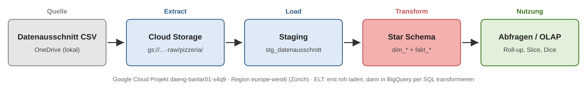
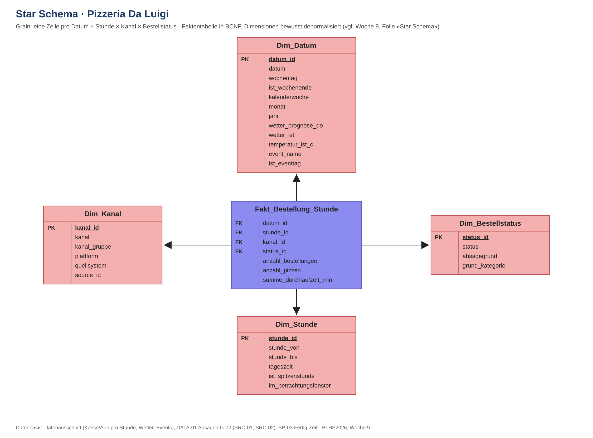
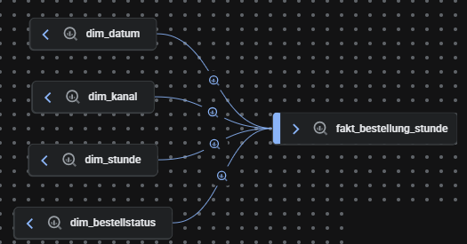

# Technische_Dokumentation_Woche9_Pizzeria_Da_Luigi

BI HS2026 · Abgabe Woche 9 (Episoden 17 und 18) · Stand 12. November 2026

# 1 Zweck und Umfang

Das Data Product führt die Bestelldaten der Pizzeria an einem Ort zusammen und macht sie für die Wochenendplanung auswertbar. Es unterstützt zwei Entscheide: Aushilfen für Freitag und Samstag (am Mittwoch) und Teigmenge (am Vortag).

Kern ist ein Star Schema in BigQuery. Angenommene und abgelehnte Bestellungen stehen in derselben Faktentabelle, damit die Nachfrage pro Stunde und Kanal berechenbar ist. Damit wird die Lücke G-02 (abgelehnte Bestellungen unsichtbar) im Datenmodell abgebildet.

Die Daten sind synthetisch (fiktiver Fall). Pipeline, Modell und Tests sind so gebaut, dass echte Daten aus SRC-01 und SRC-02 ohne Umbau geladen werden können.

# 2 Zielarchitektur und Pipeline

*Abb. 1: Datenfluss vom Rohdatum zum analysefähigen Datenprodukt*

Gewählt ist ELT: Die Datei wird zuerst unverändert in Cloud Storage abgelegt und roh in eine Staging-Tabelle geladen. Die Transformation läuft danach per SQL in BigQuery selbst. Das passt hier, weil die Daten klein sind und keine Personendaten enthalten. Der Compliance-Nachteil von ELT (sensible Daten liegen ungefiltert im Zielsystem) fällt damit weg.

| **Komponente**           | **Wert**                                                                                                                       |
|--------------------------|--------------------------------------------------------------------------------------------------------------------------------|
| Google-Cloud-Projekt     | daeng-banlar01-x4q9                                                                                                            |
| Region                   | europe-west6 (Zürich)                                                                                                          |
| Rohdaten (Cloud Storage) | gs://daeng-banlar01-x4q9-raw/pizzeria/datenausschnitt_v1.csv (16 469 Bytes)                                                    |
| BigQuery-Dataset         | pizzeria_dwh                                                                                                                   |
| Code (privates Git-Repo) | larabng/daeng-hs26-gcp-banlar01, Ordner sql/pizzeria_star_schema/                                                              |
| SQL-Dateien              | 01_ddl.sql (Tabellen) · 02_dimensionen.sql (feste Dimensionen) · 03_elt.sql (Laden und Transformation) · 04_checks.sql (Tests) |

# 3 Datenmodell

*Abb. 2: Star Schema mit der Faktentabelle in der Mitte*

## 3.1 Grain

Eine Zeile der Faktentabelle steht für eine Kombination aus Datum × Stunde × Kanal × Bestellstatus. Diese Ebene entspricht dem vorhandenen Datenausschnitt (Werte pro Stunde und Kanal) und erlaubt Roll-up auf Abend, Tag und Kanalgruppe.

## 3.2 Normalisierung

Die Faktentabelle ist in BCNF: Ihr Schlüssel ist die Kombination der vier FKs, und die drei Kennzahlen hängen nur von diesem ganzen Schlüssel ab. Es gibt keine partiellen und keine transitiven Abhängigkeiten.

Wetter, Temperatur und Event gelten pro Tag (datum → wetter_ist). In der Faktentabelle wären sie eine partielle Abhängigkeit und würden schon die 2NF verletzen. Sie stehen deshalb in dim_datum. Die Dimensionen sind bewusst denormalisiert (z. B. kanal → kanal_gruppe); die Redundanz wird aus Performancegründen in Kauf genommen (Folie «Star Schema», Woche 9).

Personal im Einsatz (pro Datum und Stunde) und Teigmenge (pro Datum) haben einen anderen Grain. Sie gehören nicht in diese Faktentabelle, sondern bei Bedarf in eigene Faktentabellen.

# 4 Data Dictionary

## 4.1 fakt_bestellung_stunde

| **Spalte**              | **Typ** | **Schlüssel** | **Beschreibung**                                              |
|-------------------------|---------|---------------|---------------------------------------------------------------|
| datum_id                | INT64   | FK, Teil PK   | Verweis auf dim_datum                                         |
| stunde_id               | INT64   | FK, Teil PK   | Verweis auf dim_stunde                                        |
| kanal_id                | INT64   | FK, Teil PK   | Verweis auf dim_kanal                                         |
| status_id               | INT64   | FK, Teil PK   | Verweis auf dim_bestellstatus                                 |
| anzahl_bestellungen     | INT64   |               | Anzahl Bestellungen in dieser Stunde, diesem Kanal und Status |
| anzahl_pizzen           | INT64   |               | Anzahl Pizzen; NULL wenn unbekannt (bei Absagen)              |
| summe_durchlaufzeit_min | INT64   |               | Summe der Durchlaufzeiten; vorerst NULL, ab SP-03 Fertig-Zeit |

## 4.2 dim_datum

| **Spalte**         | **Typ**    | **Beschreibung**                          |
|--------------------|------------|-------------------------------------------|
| datum_id           | INT64 (PK) | Datum als JJJJMMTT                        |
| datum              | DATE       | Kalenderdatum                             |
| wochentag          | STRING     | Mo bis So                                 |
| ist_wochenende     | BOOL       | Sa oder So                                |
| kalenderwoche      | INT64      | ISO-Kalenderwoche                         |
| monat, jahr        | INT64      | Monat und Jahr                            |
| wetter_prognose_do | STRING     | Wetterprognose vom Donnerstag (noch leer) |
| wetter_ist         | STRING     | sonnig, bewölkt, Regen                    |
| temperatur_ist_c   | INT64      | Tagestemperatur in °C                     |
| event_name         | STRING     | z\. B. Dorffest; NULL ohne Event          |
| ist_eventtag       | BOOL       | Event an diesem Tag                       |

## 4.3 dim_stunde

| **Spalte**             | **Typ**    | **Beschreibung**                                            |
|------------------------|------------|-------------------------------------------------------------|
| stunde_id              | INT64 (PK) | Volle Stunde 11 bis 22                                      |
| stunde_von, stunde_bis | TIME       | Beginn und Ende des Zeitfensters                            |
| tageszeit              | STRING     | Mittag (11–14), Nachmittag (15–16), Abend (17–22)           |
| ist_spitzenstunde      | BOOL       | 19 und 20 Uhr                                               |
| im_betrachtungsfenster | BOOL       | 17 bis 22 Uhr (Rahmen aus System Charter und Mission Brief) |

## 4.4 dim_kanal

| **kanal_id** | **kanal**                | **kanal_gruppe** | **plattform** | **quellsystem**     | **source_id**   |
|--------------|--------------------------|------------------|---------------|---------------------|-----------------|
| 1            | vor Ort                  | Kasse            | –             | Kasse               | SRC-01          |
| 2            | Telefon                  | Kasse            | –             | Kasse / Strichliste | SRC-01          |
| 3            | Just Eat                 | App              | Just Eat      | Partner-Portal      | SRC-02          |
| 4            | Uber Eats                | App              | Uber Eats     | Partner-Portal      | SRC-02          |
| 9            | Kasse (nicht aufgeteilt) | Kasse            | –             | Kasse               | Datenausschnitt |
| 10           | App (nicht aufgeteilt)   | App              | –             | Partner-Portal      | Datenausschnitt |

*Die Zeilen 9 und 10 nehmen den Datenausschnitt auf, der Kanäle nur als Gruppen kennt. Die Zeilen 1 bis 4 sind für die Daten aus dem Pilot vorbereitet.*

## 4.5 dim_bestellstatus

| **status_id** | **status** | **absagegrund**   | **grund_kategorie** |
|---------------|------------|-------------------|---------------------|
| 1             | angenommen | –                 | –                   |
| 2             | abgelehnt  | Küche ausgelastet | Kapazität           |
| 3             | abgelehnt  | Teig aus          | Verfügbarkeit       |
| 4             | abgelehnt  | Wartezeit zu lang | Kunde verzichtet    |
| 5             | abgelehnt  | ohne Angabe       | unbekannt           |

# 5 Transformationslogik

| **Nr.** | **Regel**                                                                                                                                                                          |
|---------|------------------------------------------------------------------------------------------------------------------------------------------------------------------------------------|
| T1      | CSV wird mit fester Spaltenliste geladen (alle 11 Spalten STRING). Ohne Spaltenliste erkennt BigQuery die Typen selbst; das hat beim ersten Lauf das Staging-Schema überschrieben. |
| T2      | Leere Werte werden vor jedem Cast zu NULL: NULLIF(TRIM(x), '').                                                                                                                    |
| T3      | dim_datum: eine Zeile pro Datum aus der CSV, inkl. Wetter und Event.                                                                                                               |
| T4      | stunde «19:00» → stunde_id 19.                                                                                                                                                     |
| T5      | «Kasse (vor Ort + Telefon)» → kanal_id 9, «App» → kanal_id 10.                                                                                                                     |
| T6      | Pro CSV-Zeile eine Faktenzeile mit status_id 1 (angenommen): anzahl_bestellungen, anzahl_pizzen.                                                                                   |
| T7      | Ist bestellungen_abgelehnt_app gefüllt (auch 0), zusätzlich eine Zeile mit status_id 5; anzahl_pizzen = NULL.                                                                      |
| T8      | Bei der Kasse ist das Absagefeld leer = unbekannt. Es wird keine Absage-Zeile angelegt, damit «unbekannt» nicht als «0 Absagen» erscheint.                                         |
| T9      | Das Laden ist wiederholbar: Ein erneuter Lauf erzeugt denselben Zustand ohne Duplikate.                                                                                            |

# 6 Metriken

Einheitliche Definitionen, damit alle Auswertungen dasselbe meinen:

| **Metrik**               | **Definition**                                          | **Hinweis**                                    |
|--------------------------|---------------------------------------------------------|------------------------------------------------|
| Angenommene Bestellungen | SUM(anzahl_bestellungen) mit status = angenommen        |                                                |
| Abgelehnte Bestellungen  | SUM(anzahl_bestellungen) mit status = abgelehnt         | heute nur App-Kanal erfasst                    |
| Nachfrage                | Angenommene + abgelehnte Bestellungen                   | Untergrenze, solange Kasse-Absagen fehlen      |
| Absagequote              | Abgelehnte / Nachfrage                                  | nur pro Kanal mit erfassten Absagen sinnvoll   |
| Pizzen pro Bestellung    | SUM(anzahl_pizzen) / SUM(anzahl_bestellungen)           | nur angenommene Bestellungen                   |
| Ø Durchlaufzeit          | SUM(summe_durchlaufzeit_min) / SUM(anzahl_bestellungen) | ab SP-03; als Summe gespeichert, damit additiv |

# 7 Datenqualitätstests

Alle Tests stehen in 04_checks.sql und sind am 12. November 2026 bestanden. Weil BigQuery PK und FK nicht erzwingt (NOT ENFORCED), übernehmen die Tests 2 und 3 diese Prüfung.

| **Nr.** | **Test**                                                 | **Erwartet**                     | **Ergebnis** |
|---------|----------------------------------------------------------|----------------------------------|--------------|
| 1       | Summen Staging = Fakten                                  | 1 294 Bestellungen, 2 718 Pizzen | PASS         |
| 2       | Keine doppelten Schlüssel in der Faktentabelle           | 0                                | PASS (0)     |
| 3       | Keine verwaisten FKs (alle vier Dimensionen)             | 0                                | PASS (0)     |
| 4       | Roll-up Nachfrage pro Datum und Kanalgruppe              | 12 Tage × 2 Gruppen = 24 Zeilen  | PASS         |
| 5       | Slice nur Regentage                                      | 4 Regentage                      | PASS         |
| 6       | Zeilen der Faktentabelle                                 | 432 (144 + 144 + 144)            | PASS         |
| 7       | Summe App-Absagen                                        | 9                                | PASS         |
| 8       | Wetter, Temperatur, Event, Wochentag pro Datum eindeutig | je 1 Wert pro Datum              | PASS         |
| 9       | Staging-Schema                                           | 11 Spalten, alle STRING          | PASS         |

| **Tabelle**            | **Zeilen** |
|------------------------|------------|
| stg_datenausschnitt    | 288        |
| dim_datum              | 12         |
| dim_stunde             | 12         |
| dim_kanal              | 6          |
| dim_bestellstatus      | 5          |
| fakt_bestellung_stunde | 432        |

# 8 Lineage

*Abb. 3: Lineage der Faktentabelle in BigQuery (Tab «Lineage»)*

BigQuery zeichnet die Herkunft automatisch auf. Die Grafik zeigt, aus welchen Tabellen fakt_bestellung_stunde beim Laden befüllt wurde. Sie belegt den Datenfluss, ist aber kein Datenmodell: Spalten, Schlüssel und Kennzahlen zeigt nur das Star Schema in Abbildung 2. Die vollständige Kette lautet G-02 → SRC-01, SRC-02 → DATA-01 → stg_datenausschnitt → Star Schema.

# 9 Bekannte Grenzen

- Synthetische Daten: Alle Werte sind simuliert. Aussagen über die echte Nachfrage sind erst mit den Pilotdaten vom 13./14. und 20./21. November möglich.

- Absagen an der Kasse fehlen. Die Nachfrage ist deshalb eine Untergrenze.

- Der Datenausschnitt kennt Kanäle nur als Gruppen (Kasse, App). Auswertungen nach Telefon, vor Ort, Just Eat oder Uber Eats sind erst mit SRC-01 und SRC-02 möglich.

- Zeitraum: Der Datenausschnitt umfasst Sa/So 11 bis 22 Uhr, der Projektrahmen ist Fr/Sa 17 bis 22 Uhr. Das Modell deckt beides ab (Feld im_betrachtungsfenster); für Auswertungen muss das Team einen Rahmen festlegen.

- Die Absagegründe 2 bis 4 sind eine Annahme des Teams und werden mit der Liste aus SRC-01 abgeglichen.

- wetter_prognose_do und summe_durchlaufzeit_min sind noch leer.

- Keine Historisierung: Ändert sich ein Dimensionswert (z. B. eine Kanalbezeichnung), wird er überschrieben (SCD Typ 1).

- Wer das Skript unter Windows PowerShell 5.1 ausführt, verliert die Umlaute. Ausführen in Git Bash mit PYTHONUTF8=1.

# 10 Betrieb

Erneut ausführen (Git Bash, im Repo):

PYTHONUTF8=1 bq query --use_legacy_sql=false \< sql/pizzeria_star_schema/03_elt.sql

Danach 04_checks.sql auf dieselbe Weise ausführen. Neue Daten werden zuerst als neue Datei im Bucket abgelegt (z. B. datenausschnitt_v2.csv) und dann über dieselbe Pipeline geladen.
